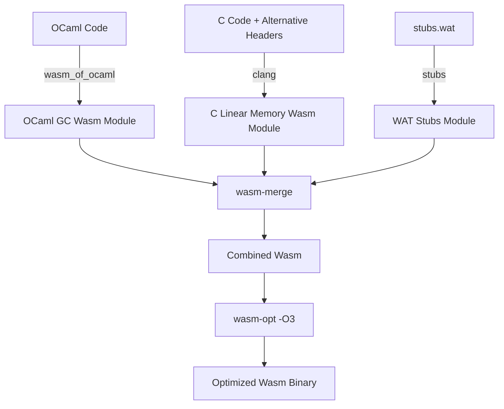

# Compiling and Linking C Code with Wasm_of_ocaml

This document outlines the current manual process for compiling C code and linking it with **wasm_of_ocaml**, and presents a design proposal for streamlining this workflow by modifying the compiler.

---

## Part 1: Current Implementation Strategy

Interfacing OCaml and C in a WebAssembly GC environment is different from a traditional native target due to partitioned memory spaces (the WebAssembly GC heap vs flat linear memory) and different value representation formats.

### 1. Architectural Overview

1. **Memory Spaces**: WebAssembly GC values live on the Wasm engine's garbage-collected heap. Standard C pointer operations can only target WebAssembly **linear memory**.
2. **Type representation**: `wasm_of_ocaml` uses WebAssembly GC reference types (`eqref`, `$block`, `$bytes`) internally. C code compiled with Clang represents opaque host values as `externref` (`__externref_t`).
3. **The Adapter Layer**: We bridge the gap using an alternative `caml/mlvalues.h` header on the C side and hand-written WebAssembly Text (WAT) stubs to convert types and copy buffers.

The strict partitioning is the source of most constraints in this document, but it is also a safety property in its own right: unlike native OCaml, where a buffer overflow in a C stub corrupts the OCaml heap, a memory bug in the C code here is confined to the C module's linear memory. For programs embedding crufty or untrusted C libraries, this architecture is *safer* than the native one, not merely compatible with it.



---

### 2. The Alternative C Headers (`caml/mlvalues.h`)

Since C code cannot read the GC heap directly, we redefine standard OCaml C binding macros to invoke imported helper functions.

```c
#ifndef CAML_MLVALUES_H
#define CAML_MLVALUES_H

#include <stddef.h>
#include <stdint.h>

/* OCaml values are represented as opaque WebAssembly external references */
typedef __externref_t value;

/* Same auxiliary types as the native headers (32-bit on wasm32), so that
 * bindings using intnat / mlsize_t compile unchanged. */
typedef int32_t intnat;
typedef uint32_t uintnat;
typedef uintnat mlsize_t;
typedef unsigned int tag_t;

/* Helper functions are imported from the "stubs" Wasm module (rather than
 * clang's default "env"), matching the module name used at the merge step. */
#define CAML_HELPER __attribute__((import_module("stubs")))

/* Primitive conversions */
CAML_HELPER value caml_val_int(intnat i);
CAML_HELPER intnat caml_int_val(value v);
CAML_HELPER value caml_val_double(double d);
CAML_HELPER double caml_double_val(value v);

#define Val_long(x) caml_val_int(x)
#define Long_val(x) caml_int_val(x)
#define Val_int(x) caml_val_int(x)
#define Int_val(x) caml_int_val(x)
#define Val_double(x) caml_val_double(x)
#define Double_val(x) caml_double_val(x)

#define Val_unit caml_val_int(0)
#define Val_true caml_val_int(1)
#define Val_false caml_val_int(0)
#define Val_bool(x) caml_val_int((x) ? 1 : 0)
#define Bool_val(x) caml_int_val(x)

/* Block fields and Tags
 * Under wasm_of_ocaml, blocks are Wasm GC arrays where index 0 stores the tag
 * (as an i31ref) and the fields start at index 1.
 */
CAML_HELPER value caml_field(value v, mlsize_t i);
CAML_HELPER void caml_store_field(value v, mlsize_t i, value w);
CAML_HELPER tag_t caml_tag_val(value v);
CAML_HELPER mlsize_t caml_wosize_val(value v);

#define Field(v, i) caml_field(v, i)
#define Store_field(v, i, w) caml_store_field(v, i, w)
#define Tag_val(v) caml_tag_val(v)
#define Wosize_val(v) caml_wosize_val(v)

/* Flat float arrays are a distinct Wasm GC type; Field/Store_field are
 * invalid on them (see Part 6).
 */
CAML_HELPER double caml_double_field(value v, mlsize_t i);
CAML_HELPER void caml_store_double_field(value v, mlsize_t i, double d);

#define Double_field(v, i) caml_double_field(v, i)
#define Store_double_field(v, i, d) caml_store_double_field(v, i, d)

/* Strings & Bytes
 * GC array characters must be copied to linear memory on demand. Buffers
 * obtained via Bytes_val are copied back into the GC array when the C
 * function returns (see Part 6).
 */
CAML_HELPER mlsize_t caml_string_length(value v);
CAML_HELPER const char* caml_string_val(value v);
CAML_HELPER char* caml_bytes_val(value v);

#define String_val(v) caml_string_val(v)
#define Bytes_val(v) caml_bytes_val(v)

/* This header is an excerpt. The shipped header additionally covers
 * allocation (caml_alloc, caml_alloc_tuple, caml_copy_string,
 * caml_copy_double, ...), caml_stat_alloc / caml_stat_free (mapped to
 * linear-memory malloc / free), exceptions, callbacks, etc.
 */

#endif /* CAML_MLVALUES_H */
```

---

### 3. Wasm GC Stubs (`stubs.wat`)

The WAT stub imports C functions, translates signatures between `(ref eq)` and `externref` types via conversion instructions, and implements GC operations.

```wat
(module
   ;; Import linear memory and allocators exported by the compiled C module
   (import "c_module" "c_memory" (memory 1))
   (import "c_module" "malloc" (func $malloc (param i32) (result i32)))
   
   ;; Import C functions that we want to wrap
   (import "c_module" "my_c_binding" (func $my_c_binding (param externref) (result externref)))

   ;; Wasm GC type definitions matching wasm_of_ocaml
   (type $float (struct (field $f f64)))
   (type $block (array (mut (ref eq))))
   (type $bytes (array (mut i8)))

   ;; Val_int: Int -> externref
   (func (export "caml_val_int") (param $i i32) (result externref)
      (extern.convert_any (ref.i31 (local.get $i))))

   ;; Int_val: externref -> Int
   (func (export "caml_int_val") (param $v externref) (result i32)
      (i31.get_s (ref.cast (ref i31) (any.convert_extern (local.get $v)))))

   ;; Val_double: f64 -> externref
   (func (export "caml_val_double") (param $d f64) (result externref)
      (extern.convert_any (struct.new $float (local.get $d))))

   ;; Double_val: externref -> f64
   (func (export "caml_double_val") (param $v externref) (result f64)
      (struct.get $float $f (ref.cast (ref $float) (any.convert_extern (local.get $v)))))

   ;; Field Access: returns field (i + 1) because index 0 is reserved for the tag
   (func (export "caml_field") (param $v externref) (param $i i32) (result externref)
      (extern.convert_any
         (array.get $block
            (ref.cast (ref $block) (any.convert_extern (local.get $v)))
            (i32.add (local.get $i) (i32.const 1)))))

   ;; Store Field: sets field (i + 1)
   (func (export "caml_store_field") (param $v externref) (param $i i32) (param $w externref)
      (array.set $block
         (ref.cast (ref $block) (any.convert_extern (local.get $v)))
         (i32.add (local.get $i) (i32.const 1))
         (any.convert_extern (local.get $w))))

   ;; String Copying: Copy GC bytes into C linear memory, returns pointer
   ;; WARNING: This manual implementation allocates via malloc but has no automatic way 
   ;; of freeing it, causing permanent leaks unless explicitly freed by the C side.
   ;; The streamlined compiler design solves this using a scoped bump allocator.
   (func (export "caml_string_val") (param $v externref) (result i32)
      (local $len i32) (local $addr i32) (local $i i32) (local $bytes_ref (ref $bytes))
      (local.set $bytes_ref (ref.cast (ref $bytes) (any.convert_extern (local.get $v))))
      (local.set $len (array.len (local.get $bytes_ref)))
      (local.set $addr (call $malloc (i32.add (local.get $len) (i32.const 1))))
      (local.set $i (i32.const 0))
      (block $done
         (loop $loop
            (br_if $done (i32.eq (local.get $i) (local.get $len)))
            (i32.store8
               (i32.add (local.get $addr) (local.get $i))
               (array.get_u $bytes (local.get $bytes_ref) (local.get $i)))
            (local.set $i (i32.add (local.get $i) (i32.const 1)))
            (br $loop)))
      (i32.store8 (i32.add (local.get $addr) (local.get $len)) (i32.const 0))
      (local.get $addr))

   ;; OCaml Primitive Bridge wrapper: maps signatures
   (func (export "caml_my_c_binding") (param $v (ref eq)) (result (ref eq))
      (ref.cast (ref eq)
         (any.convert_extern
            (call $my_c_binding
               (extern.convert_any (local.get $v))))))
)
```

---

### 4. Compilation and Linking Commands

1. **Compile C Code**:
   ```bash
   /opt/wasi-sdk/bin/clang -O3 -flto \
     -mbulk-memory -mreference-types \
     -mexec-model=reactor \
     -Wl,--allow-undefined \
     -Wl,--export-memory=c_memory \
     -Wl,--export=malloc \
     my_bindings.c -o c_module.wasm
   ```
   - The WASI SDK links **wasi-libc** by default, so `malloc`, `string.h`, etc. are available; `-mexec-model=reactor` builds a library-style module (with an `_initialize` entry point instead of `_start`). The module's WASI imports (`wasi_snapshot_preview1.*`) must be satisfied at instantiation — by a WASI shim, or by trivial stubs when the bindings perform no I/O.
   - `-Wl,--allow-undefined` is required because the C code imports the `caml_*` helper functions. The alternative header declares them with `__attribute__((import_module("stubs")))`, so clang emits imports from the `stubs` module (matching the module name used at the merge step) rather than the default `env`.
2. **Compile OCaml Code**:
   ```bash
   ocamlfind ocamlc -package ... -linkpkg main.ml -o main.byte
   wasm_of_ocaml main.byte -o main.js
   ```
   `wasm_of_ocaml` consumes OCaml *bytecode* and produces `main.js` (the JavaScript launcher) together with a `main.assets/` directory containing the Wasm module (`code-<hash>.wasm`). That module is the input to the merge step below.
3. **Merge and Link Wasm Modules** (`wasmoo_link_wasm` drives Binaryen's `wasm-merge` and `wasm-opt`, as shown in the diagram above; the output file is the first positional argument):
   ```bash
   wasmoo_link_wasm \
     app.wasm \
     c_module:c_module.wasm \
     stubs:stubs.wat \
     ocaml_module:main.assets/code-<hash>.wasm
   ```
   The merged and optimized module then replaces the original one in `main.assets/` (keeping its file name) so that `main.js` loads it.

---

## Part 2: Proposed Compiler Streamlining

Writing manual WAT stubs for every external function is tedious. We propose modifications to `wasm_of_ocaml` to automate this workflow.

### 1. Automatic Wrapper Generation (Auto-Stubs)

Instead of manual stub files, we can modify the compiler to generate marshaling wrappers directly during compiling. To maximize compatibility with existing C bindings written for the regular OCaml compiler, the auto-generated wrappers will retain the use of OCaml's `value` type (represented as `externref` in WebAssembly) rather than unboxing arguments to standard C types.

For every OCaml declaration:
```ocaml
external my_c_function : int -> string -> float -> unit = "my_c_function"
```
The compiler can automatically output the correct wrapper function:
- Converts all OCaml GC values (e.g., `i31ref`, `$float` structs, GC arrays) into opaque Wasm `externref` values.
- Invokes the corresponding C function, which accepts and returns `externref` (typedef'd as `value` in the alternative C headers).
- Restores the Wasm GC type from the returned `externref` before yielding execution back to OCaml.

This approach ensures that existing C code utilizing standard macros (`Int_val`, `Double_val`, `String_val`) requires minimal to no modifications to be compiled for WebAssembly.

### 2. Built-in C-API Bridge Runtime

Instead of requiring developers to include helper implementations (`caml_field`, `caml_alloc`) in their stubs, `wasm_of_ocaml` should integrate them directly into the runtime (`runtime/wasm/obj.wat` and `gc.wat`).
- A single static `caml/mlvalues.h` file can then be shipped with `wasm_of_ocaml` and reused across all projects without modifications.
- Standard C bindings can be compiled directly against these runtime helper exports.

### 3. Toolchain Integration

Extend the `wasm_of_ocaml` CLI to invoke clang and link the compiled linear memory output directly:
```bash
wasm_of_ocaml main.byte --link-c-file=my_bindings.c -o main.js
```
Under the hood, the compiler CLI will find `clang` (from the WASI-SDK), run the compilation with the proper flags (LTO, Reference Types), and bundle everything via `wasm-merge` automatically. The flag must be accepted both by the whole-program `compile` subcommand and by the separate-compilation `link` subcommand (used by dune's dev profile), since primitive resolution happens at link time in the latter mode (see Part 5).

### 4. Linking Multiple C Libraries in a Single Step

When a program uses several C-backed libraries, merging independently compiled C Wasm modules with `wasm-merge` yields duplicate symbols: two copies of libc, two `malloc`s, two heaps that cannot exchange pointers. The toolchain integration should therefore collect *all* C sources and archives and perform a **single clang / `wasm-ld` link**, restoring ordinary C linking semantics — one allocator, cross-library calls, a deduplicated libc. Keeping one module per library remains a deliberate option for isolation (the multi-memory proposal makes it principled), but it must be a choice, not an accident of the pipeline.

### 5. Build System Integration (dune / findlib)

A `--link-c-file` flag assumes the user lists C files by hand at link time, but the information already exists in build metadata: dune's `(foreign_stubs ...)` stanzas, and the `dllibs` and primitives recorded in `.cma` files. If dune (or a findlib convention) carried the C sources — or the compiled C Wasm module — alongside each library, linking a Wasm executable would pick up C stubs **transitively**, exactly like native linking does. Without this, "existing bindings compile out of the box" is only true for whoever writes the link command by hand; with it, `dune build` on an unmodified project just works. This is arguably the largest remaining gap between the design and real-world adoption.

### 6. Portable Prebuilt Binding Artifacts

A compiled C Wasm module is architecture-independent — unlike a native `.o`. A package like `zarith` can therefore build its C module (GMP included) once in CI and ship the blob in its opam package; downstream users need no WASI SDK and no clang. Native OCaml could never do this. It changes the distribution story from "every user needs a cross toolchain" to "only binding authors do".

---

## Part 3: ABI Compatibility and Runtime Integration

To maintain seamless compatibility with standard C bindings, the design relies heavily on WebAssembly's native features and the existing `wasm_of_ocaml` Wasm runtime.

### 1. Memory Management for Strings and Bytes
Because C code written for the OCaml C-ABI expects strings to be managed by the GC (and potentially moved), it does not attempt to `free()` them. To support this in Wasm linear memory:
- Auto-generated wrappers will utilize a **scoped bump-allocator** (or shadow stack) in Wasm linear memory to copy GC string data.
- The wrapper allocates linear memory, passes the pointer to the C function, and immediately resets the bump-allocator's stack pointer after the C function returns.
- This safely provides C with a temporary linear memory pointer without causing memory leaks.

### 2. GC Roots and `CAMLparam` / `CAMLlocal`
WebAssembly GC automatically traces `externref` variables that are held on the Wasm execution stack or within Wasm locals. Therefore, GC root tracking for function local variables is handled natively.
However, to manage the scope of temporary allocations (like the bump allocator stack pointer), we implement a **hybrid scoping strategy**:
- **Macro Redefinitions:** The `caml/mlvalues.h` header will redefine `CAMLparam` to record the current bump allocator stack pointer, and `CAMLreturn` / `CAMLreturn0` to restore it. This enables fine-grained, frame-local cleanup of transient strings and bytes.
- **Wrapper Safety Net:** Redefining the macros does not protect against functions that omit `CAMLparam`/`CAMLreturn` entirely (e.g., short utility functions). To guarantee leak-free execution, the compiler-generated external Wasm-to-C wrapper will also save the bump pointer before calling the C function and restore it as a safety-net reset after the function returns.

### 3. Callbacks and Exceptions
Operations like invoking closures (`caml_callback`) and raising exceptions (`caml_failwith`) do not require new Wasm GC stubs. These functions are already implemented natively within the `wasm_of_ocaml` runtime (`runtime/wasm/`). 
The C module simply imports these existing functions from the Wasm runtime environment. When C code calls `caml_callback(closure_val, arg_val)`, it passes the `externref` arguments to the runtime, which handles the Wasm GC unboxing and execution automatically.

**Exception Safety Caveat:**
Because `wasm_of_ocaml` raises exceptions via native WebAssembly Exceptions, throwing an exception propagates through the Wasm stack. If a Wasm exception propagates through a C function, standard C compiled with Clang does not catch it. Any cleanup blocks, `free()` calls, or resource releases in the C function will be bypassed, leading to resource leaks.
* *Best Practice:* Inside C bindings that allocate linear memory resources or modify global state, developers should call OCaml callbacks using `caml_callback_exn` instead of `caml_callback`. This allows the C code to catch the exception value, release local resources, and then explicitly re-raise the exception.

---

## Part 4: Custom Blocks and Finalization

Custom blocks in OCaml are often used to wrap C pointers and attach finalization functions that `free` underlying resources when the block is garbage collected. Supporting this in WebAssembly GC introduces specific challenges, primarily because native Wasm GC **does not currently support finalizers**.

### 1. Representation and Faking the Finalizer Token
Since the custom C struct must live in Wasm linear memory, `caml_alloc_custom` generates a Wasm GC object (acting as the block) that stores an `i32` linear memory pointer and a pointer to the `custom_operations` struct. `Data_custom_val(v)` simply unboxes this Wasm GC object to return the `i32` payload.

To implement finalization, the runtime relies on the host JavaScript `FinalizationRegistry` as a fallback:
1. **Registration:** During allocation, the JS host registers the Wasm GC object with the `FinalizationRegistry`. Because the JS registry does not provide access to the collected object in its callback (the object is already dead), the host passes the raw `i32` linear memory pointer and `custom_operations` pointer as the registry's "held value" token.
2. **Reconstruction:** When the JS callback fires, it receives these `i32` pointers. Because standard C finalization functions expect an `externref` (`value v`), the JS runtime **allocates a dummy Wasm GC object** containing these exact same pointers.
3. **Execution:** This dummy object is cast to an `externref` and passed to the C `finalize` function. The C code successfully reads the linear memory pointer via `Data_custom_val(v)`, frees the memory, and returns. The dummy object is then quickly garbage collected. This completely hides the underlying JavaScript limitations from the C code.

### 2. The Memory Pressure Disconnect & GC Double-Hop (Warning)
While `FinalizationRegistry` works as a best-effort mechanism, developers must be warned about **severe memory pressure risks** due to the **GC double-hop delay**:
1. When a Wasm GC object wrapping a linear memory allocation becomes garbage, the Wasm engine's GC must run first to collect it.
2. The Wasm GC then schedules a cleanup task in the JS host's `FinalizationRegistry`.
3. The JavaScript event loop must cycle and run the registered finalization callback.
4. Only then does the JS callback execute the Wasm linear memory `$free` call.

Because the Wasm/JS engine's GC is unaware of the potentially massive Wasm linear memory allocations represented by tiny Wasm GC handles, it may not trigger sweeps frequently enough. A Wasm module can easily exhaust its linear memory (triggering an OOM crash) before the double-hop finalizer cycle runs.
* *Requirement:* When targeting WebAssembly with C bindings, developers should explicitly call resource-release functions (e.g. `caml_ba_free` or custom free stubs) rather than relying on finalizers to clean up heavy allocations.

Note that native OCaml already exposes exactly the missing information: the `used` / `max` arguments of `caml_alloc_custom(ops, size, used, max)` exist to tell the GC how much external memory a custom block retains. Under WebAssembly they are currently discarded for lack of an engine API to feed them into — they are precisely what the `gc.adjust_external_memory` extension proposed in Part 8 would consume, so the C-API surface is already in place.

---

## Part 5: Primitive Resolution (OCaml Externals vs C Functions)

OCaml's `external` keyword is traditionally used both to bind to internal runtime primitives and to bind to user-defined C functions. Since `wasm_of_ocaml` relies heavily on internal Wasm runtime implementations (e.g., in `runtime/wasm/`), the compiler requires a deterministic mechanism to decide whether to link an `external` directly to the runtime or to generate a Wasm-to-C marshaling stub.

To maintain maximum compatibility without requiring code modifications (like adding `[@@wasm.c_stub]` annotations to every external), `wasm_of_ocaml` utilizes **Export Scanning**:

1. **Pre-compilation of C Code:** When developers pass C files via the `--link-c-file` CLI flag, `wasm_of_ocaml` leverages `clang` to compile the C code into a linear memory Wasm module *before* finalizing the OCaml compilation.
2. **Export Inspection:** The compiler inspects the exported symbols of the resulting C Wasm module. 
3. **Resolution Strategy:**
   - If an OCaml `external` declaration matches a symbol exported by the C Wasm module, the compiler identifies it as a user C function and **auto-generates the marshaling stub** (as described in Part 2).
   - If the symbol is not exported by the C module, the compiler assumes it is an internal `wasm_of_ocaml` runtime primitive and links it directly.

Only the *exports* of the C module participate in resolution; its imports (the `caml_*` helpers and runtime functions it consumes) are ignored by the scan.

**Collision Policy:** A symbol exported by the C module may collide with a primitive that the `wasm_of_ocaml` runtime also provides — typically when linking the original C sources of a library for which the runtime ships a curated Wasm override. Resolution must not be silent: the compiler emits a warning, the runtime implementation wins by default, and a CLI flag lets the user prefer the C implementation instead.

**Separate Compilation:** In whole-program mode, export scanning happens during `compile`. Under dune's dev profile, primitive resolution happens in the separate-compilation `link` subcommand instead, so `--link-c-file` (and the scanning logic) must be available there as well.

This approach guarantees high precision (no silent fallbacks or manual annotations required) and ensures that existing OCaml-C bindings compile out of the box with zero source code changes.

---

## Part 6: Known Limitations and Open Challenges

While the architecture outlined above aims for maximum compatibility, there are a few strict departures from the native OCaml C-ABI caused by WebAssembly constraints.

### 1. The `Bytes` Mutation Problem
In standard OCaml, C code is allowed to mutate `Bytes` objects in place via `Bytes_val(v)`. Because our Wasm GC auto-stubs copy the string/bytes buffer into a temporary linear memory bump allocator, mutations made by the C code land on that temporary copy.
- **Resolution — automatic copy-back for `Bytes_val`:** The two accessor macros follow OCaml's own documented semantics. `String_val(v)` (immutable strings) copies the data *into* linear memory only. `Bytes_val(v)` — the only sanctioned mutation path — copies in *and* automatically copies the buffer back into the Wasm GC array when the C function returns: the wrapper tracks each `(value, pointer)` pair handed out during the frame and flushes them just before resetting the bump pointer. Existing correct C code therefore keeps working with zero changes, and the copy-back cost lands only on code that declared its intent to mutate by using `Bytes_val`.
- **Opt-out for performance:** For hot paths that use `Bytes_val` for read-only access, a `caml_bytes_readonly(v)` accessor skips the copy-back. Making correctness the default and performance the opt-*out* is deliberate: the inverse design (an opt-in "mark dirty" macro) would turn the default behaviour into silent data loss for previously-correct code — the worst possible failure mode — and would contradict the zero-source-changes goal of Part 5.
  * *Real-world Case:* The `mpfr__sprintf` function in the `mlgmpidl` library (`mpfr.idl`) takes a `[string]char *STR` parameter and formats a float in place. If the generated stub obtains the buffer via `Bytes_val`, it works unchanged under automatic copy-back; if it writes through `String_val` — undefined behaviour on native OCaml too since safe-strings — the mutation is visibly lost and the stub must be switched to `Bytes_val`.

### 2. WebAssembly Reference Types (`value`) in Linear Memory
Because OCaml's `value` type is compiled to WebAssembly's `externref` (`__externref_t`), it is subject to a fundamental physical constraint of WebAssembly: **reference types cannot be stored in linear memory**.
* **Struct fields & Arrays:** Standard C bindings that define structures containing OCaml values (e.g. `struct MyStruct { value v; }`) or declare C arrays of values (e.g. `value my_array[10];`) will fail to compile.
* **Function Arguments (`value *`):** Because arrays of values cannot exist in linear memory (including the C stack), **you cannot pass arrays of values to functions via `value *`**. This permanently breaks core OCaml APIs like `caml_callbackN(value closure, int arg_count, value *args)`.
* **Address of Globals:** Code using `caml_register_global_root(&my_global_var)` is invalid if `my_global_var` is a Wasm global. Wasm globals reside outside linear memory and their addresses cannot be taken.
* **Workaround:** For bindings that absolutely require storing OCaml values in static structures, passing arrays to callbacks, or registering global roots, developers must use a handle/registry mapping system:
  ```c
  typedef int32_t caml_root; // Safe to store in linear memory
  caml_root caml_acquire_root(value v); // Allocates a handle in a Wasm table
  value caml_resolve_root(caml_root r); // Resolves handle back to externref
  void caml_release_root(caml_root r); // Releases handle
  ```

### 3. `Field` and `Byte` as L-Values
According to the OCaml C-ABI, expressions like `Field(v, n)` and `Byte(v, n)` are valid C l-values (e.g., `Field(v, 0) = x;`). 
- **The Issue:** Because Wasm GC fields cannot be accessed via direct C pointer arithmetic, these macros must expand to imported function calls (e.g., `caml_field(v, n)`). In C, function calls are r-values, so assigning to them causes a C compilation error (`expression is not assignable`).
- **Migration Requirement:** Developers porting C code to WebAssembly must mechanically replace l-value assignments with the provided `Store_field(v, n, x)` and `caml_store_byte(v, n, x)` macros.

### 4. Flat Float Arrays
OCaml stores `float array` unboxed: under `wasm_of_ocaml` it is a distinct Wasm GC type (`$float_array`, an `(array (mut f64))`), not a `$block`. Consequently `Field` / `Store_field` are invalid on float arrays; C code must use `Double_field(v, i)` and `Store_double_field(v, i, d)`, which map to dedicated helpers operating on the `$float_array` type. This is the same trap as in native OCaml (where flat float arrays also require `Double_field`), but the failure mode differs: misuse traps with a Wasm cast error at runtime instead of silently reinterpreting memory.

### 5. Persistent Pointers to Strings
Because strings and bytes are passed to C using a scoped bump allocator, any pointer returned by `String_val(v)` becomes a **dangling pointer** as soon as the C function returns. C code cannot store these interior pointers in global variables or inside custom blocks to be read later.

### 6. Multicore and Threading
OCaml 5 introduces Multicore support, but the current WebAssembly GC specification does not support sharing GC objects across threads (Shared Wasm GC is still an active proposal). This linking strategy strictly assumes a single-threaded WebAssembly execution environment.

### 7. Bigarrays and Linear Memory
Traditionally, JS-based runtimes implement Bigarrays as independent JavaScript `TypedArray`s. However, C code compiled to WebAssembly can only dereference pointers within its own specific Wasm linear memory.
- **The Design Shift:** To support passing Bigarrays to C without incurring massive copying overhead, `wasm_of_ocaml` must implement `Bigarray.create` by allocating space directly within the imported Wasm linear memory (using `$malloc`). `Caml_ba_data_val(v)` then simply yields this `i32` linear memory pointer.
  * *Real-world Case:* The `mpz__import` and `mpz__export` functions in `mlgmpidl`'s `mpz.idl` use the `[bigarray]` attribute to transfer digit arrays directly. Under Wasm GC, these stubs rely on `Caml_ba_data_val` to obtain direct linear memory pointers to the arrays.
- **Scope of the Change:** This representation switch only applies when C linking is enabled (i.e. when `--link-c-file` is used). Builds without C code keep the current `ArrayBuffer`-backed implementation with its zero-copy JavaScript interop. Note that within Wasm the new representation is likely a performance *gain* for the OCaml side: linear-memory Bigarrays are accessed with plain `i32.load` / `f64.load` instructions instead of calls to `DataView` methods.
- **Limitation 1 (Memory Pressure):** Like custom blocks, these massive linear memory allocations are tied to small Wasm GC objects. Relying on the JavaScript GC to collect the Wasm GC object and trigger the finalizer to `$free` the array is dangerous and can easily lead to linear memory exhaustion.
- **Limitation 2 (JavaScript Interop):** Existing projects often pass Bigarrays to JavaScript APIs (like WebGL). Moving Bigarrays into the Wasm linear memory means JS code must now access them by creating `TypedArray` views over the exported Wasm `memory.buffer`. If the Wasm memory dynamically grows, these JS `ArrayBuffer` views become detached and must be carefully recreated by the interop layer.
- **Limitation 3 (JS-to-OCaml Transfer):** Bigarrays created from existing JavaScript typed arrays (the `Typed_array` interop in the `js_of_ocaml` library) can no longer wrap the JS buffer in place; the data must be copied into linear memory.

### 8. Porting and Debugging Tooling

Two tools would substantially lower the porting cost created by the limitations above:
- **A migration lint:** a small libclang-based checker that scans C stub sources for the patterns this Part forbids — `value` fields in structs or arrays, `value *` parameters, `Field(...) = x` l-values, `String_val` pointers stored beyond the call, `caml_register_global_root` — and produces a porting report. It converts "compile and decode errors one at a time" into "here are the seven things to fix in this library", and, run over opam, it would give empirical data on how much of the ecosystem fits the compatibility ABI as-is.
- **A debug mode:** the design introduces new ways to go wrong silently — leaks through the finalizer double-hop (Part 4), dangling bump-allocator pointers (Section 5 above), mutations lost through a mistaken `caml_bytes_readonly` (Section 1). A debug variant of `--link-c-file` could track linear memory allocations owned by custom blocks and report leaks at exit, poison the bump region after each frame reset so that use-after-return traps instead of reading stale data, and enable the WASI SDK's ASan / UBSan for the C side. Porting effort goes where debugging is cheap.

---

## Part 7: Architectural Models for `value` Representation

To support C bindings, the design of the Wasm-C interface must choose between two distinct strategies for representing OCaml's `value` type on the C compiler side. This choice impacts performance, root-tracking overhead, and compatibility with standard OCaml C APIs (such as `caml_named_value` and global root registration).

### Model A: Reference Representation (Proposed)
```c
typedef __externref_t value;
```
In this model, the opaque `value` is directly compiled to a WebAssembly GC reference (`externref`).

* **Pros:**
  * **Zero lookup overhead:** Passing values between OCaml and C is a direct register/stack operation.
  * **Automatic Local Root Tracking:** Since C local variables of type `value` are compiled directly to WebAssembly locals, they are automatically tracked by the engine's Wasm GC. The macros `CAMLparam` / `CAMLlocal` / `CAMLreturn` perform no root registration at all (they are retained only for the bump-allocator scoping described in Part 3).
* **Cons:**
  * **No Linear Memory Storage:** Reference types cannot reside in linear memory. C structures containing fields of type `value` or static arrays of type `value` will fail to compile.
  * **Invalid Pointer Types (`value *`):** You cannot take the address of a local variable of type `value` (`&v`), nor can you have pointers like `value *`.
  * **Incompatible APIs:** Functions like `caml_callbackN(value closure, int arg_count, value *args)`, `const value * caml_named_value(const char *)`, and `caml_register_global_root(value *)` cannot compile as-is because they require `value *` pointers (which are illegal under Wasm GC). `caml_named_value` can be salvaged with a shim returning the value (or a handle) directly; `caml_callbackN` and `caml_register_global_root` require the handle API from Part 6.

### Model B: Handle Representation (Alternative)
```c
typedef int32_t value;
```
In this model, the opaque `value` is an index (handle) into a WebAssembly `Table` that holds the actual GC references.

* **Pros:**
  * **Full Pointer Compatibility:** Since `value` is a standard `int32_t`, you can safely define pointers to values (`value *`), store values in linear memory structures, and define static/global arrays of values.
  * **Compatible APIs:** Legacy functions like `caml_named_value` and `caml_register_global_root` compile and execute as-is without code changes, since they can dereference `value *` pointers in linear memory.
* **Cons:**
  * **Lookup Overhead:** Every access to an OCaml value (e.g. retrieving fields, converting scalars, passing parameters) requires resolving the index in the Wasm Table, adding performance overhead.
  * **Mandatory Root Tracking:** The `CAMLparam` / `CAMLlocal` / `CAMLreturn` macros **cannot be no-ops**. They must actively register and unregister table indices with a root tracker to prevent Wasm Table slots from leaking or being garbage collected, incurring significant C-side overhead.

### Decision
This design adopts **Model A**, combined with the opt-in handle API (`caml_acquire_root` / `caml_resolve_root` / `caml_release_root`) described in Part 6 as an escape hatch for the minority of bindings that must store values in linear memory. This hybrid keeps the common path at zero overhead — no table lookups, no root registration — while still giving legacy `value *`-based code a mechanical porting recipe.

---

## Part 8: Desired WebAssembly Extensions

The strict sandbox and memory boundaries of WebAssembly GC currently force trade-offs between compatibility and performance (such as the linear memory bump-allocator and the JS event-loop double-hop for finalizers). 

To natively support the semantics required by languages with heavy C-interop like OCaml, we identify the following two realistically implementable WebAssembly extensions that would dramatically simplify the architecture:

### 1. External Memory Pressure Hints (`gc.adjust_external_memory`)
* **The Problem:** The Wasm/JS garbage collector heuristic only sees the byte size of the small Wasm GC handle. It is completely blind to the megabytes of Wasm linear memory that a Custom Block or Bigarray might conceptually "retain". This leads to out-of-memory (OOM) crashes because the GC does not feel enough pressure to run a sweep.
* **The Extension:** Introduce a lightweight WebAssembly GC instruction, e.g., `gc.adjust_external_memory (param i32)`. This allows a Wasm module to explicitly inform the host engine's GC heuristic about the hidden weight of a GC object. 
* **Realism & Implementation Details:** Highly realistic. Major JavaScript engines already implement this exact mechanism internally for C++ bindings (e.g., V8's `v8::Isolate::AdjustAmountOfExternalAllocatedMemory`). Implementing this as a global module-level counter (where the program calls `+N` on allocation and `-N` on deallocation) is trivial for engines to support because it avoids modifying Wasm GC object layouts.

### 2. Predictable / Post-Sweep Wasm Finalizers
* **The Problem:** Relying on JavaScript's `FinalizationRegistry` forces finalization to wait for the JavaScript event loop to yield, which is dangerously late for linear memory management.
* **The Extension:** Introduce a **post-sweep finalization queue**. To prevent security and deadlock risks, the Wasm specification can forbid executing arbitrary Wasm callbacks *during* the GC pause. Instead, the Wasm engine can queue finalizers during GC and execute them synchronously at **explicit safe points**:
  * **When the Wasm call stack is empty** (at the boundary of the entry-level call).
  * **At explicit polling checkpoints** (e.g. via a new `gc.poll_finalizers` instruction).
  * **At JSPI stack suspension/yield points** (when the execution stack is suspended, returning control to the JS event loop).
* **Realism & Reentrancy Mitigation:** Realistic. By executing finalizers at these well-defined boundary states, the engine completely eliminates the risk of **reentrancy** (where a finalizer runs in the middle of an active Wasm function and breaks state invariants), while guaranteeing that finalization still runs promptly even in long-lived or suspended Web Worker contexts.

---

## Part 9: Extending the Design to the JavaScript Target (`js_of_ocaml`)

Most of this design is target-independent. The C-facing surface is just an ABI: an opaque `value`, a set of `caml_*` helpers imported from the `stubs` module, and copy-in/copy-out for strings and bytes. Nothing in that contract requires the helpers to be implemented in Wasm GC — they can equally be implemented in JavaScript, making the same C bindings work with `js_of_ocaml`.

### 1. A Target-Independent C ABI

The key decision is to freeze the C-side ABI — the alternative `caml/mlvalues.h` and the `stubs` import interface — as **target-independent**, with two implementations of the `stubs` module:
- the WAT implementation of Part 1, merged in by `wasm_of_ocaml`;
- a JavaScript implementation, supplied at instantiation time by `js_of_ocaml`.

The **same compiled `c_module.wasm`** then works for both targets. Libraries like `zarith` or `mlgmpidl` get a single porting story, instead of the hand-written JavaScript runtime reimplementations they require today.

### 2. Why the JavaScript Side Is Simpler

- **`externref` is a JS value.** In a Wasm module instantiated from JavaScript, `__externref_t` holds arbitrary JS values with zero conversion cost at the boundary. The `extern.convert_any` / `any.convert_extern` machinery of the WAT stubs disappears entirely.
- **Trivial helpers.** `js_of_ocaml` blocks are JS arrays with the tag at index 0 — the same layout convention as the Wasm GC representation. So `caml_field(v, i)` is `v[i + 1]`, `caml_tag_val(v)` is `v[0]`, and `caml_val_double` is the identity. The bump allocator and the `Bytes_val` copy-back (Part 6) are a few lines of JS operating on the C module's exported memory.
- **Existing runtime machinery transfers.** `caml_callback`, `caml_failwith`, custom blocks (`FinalizationRegistry` is directly at hand), and export scanning for primitive resolution (Part 5) all carry over. JS exceptions propagate through Wasm C frames with the same "cleanup is skipped" caveat as Part 3.
- **Representation edges are absorbed by the helpers.** JS strings vs `MlBytes`, `MlInt64` for int64, etc. are handled inside the helper implementations, invisible to the C side.

### 3. Costs Specific to the JavaScript Target

1. **Startup becomes asynchronous.** `js_of_ocaml` output today runs synchronously at load; instantiating the C module requires `WebAssembly.instantiate` (synchronous compilation is size-restricted on browser main threads). Using `--link-c-file` on the JS target therefore implies a `wasm_of_ocaml`-style asynchronous launcher plus an assets story for the `.wasm` file. This is opt-in, but it changes the output shape (bundlers, CSP `wasm-unsafe-eval`).
2. **Boundary-crossing overhead.** On the Wasm GC target, the stubs are merged and inlined by `wasm-opt`; on the JS target, every `Field` / `Int_val` is a Wasm-to-JS call. These calls are cheap in modern engines but not free — a chatty binding will feel it.
3. **Bigarrays are actually less disruptive.** The design shift of Part 6 applies, but `js_of_ocaml` Bigarrays are already `TypedArray`s, so backing them with views over the C module's `memory.buffer` mostly preserves existing JS interop (modulo the detach-on-grow caveat).

### 4. Design Consequence

Even if the `js_of_ocaml` backend comes later, the ABI should be designed for it *now*: keep the header and the `stubs` import interface free of anything specific to Wasm GC. The design as specified in Parts 1–7 already satisfies this constraint.

---

## Part 10: Retargeting Stub Generators (camlidl, ctypes)

The compatibility ABI of Parts 1–8 exists for bindings that *cannot* be regenerated: hand-written C stubs. But a large share of the ecosystem's bindings are generated — camlidl for `mlgmpidl` (and Apron behind it), ctypes for much of the rest. For those, retargeting the generator is a complementary second tier, and strictly better than faithfully emulating the C API, because the generator has information the compatibility layer must guess at.

### 1. What Generators Know That the ABI Layer Doesn't

- **Directionality.** camlidl's IDL has `in` / `out` attributes; ctypes' `typ` GADT states exactly how each argument crosses the boundary. This dissolves the `Bytes` mutation problem (Part 6) at the root: no heuristic copy-back, no read-only opt-out — the generated stub copies in, out, or both, exactly as declared. The `mpfr__sprintf` case (`[string] char *STR`) is precisely one where the IDL already says what the compatibility layer cannot know.
- **Full signatures.** The generator can emit a wrapper that converts Wasm GC values straight to C ABI scalars (`i32`, `f64`, linear memory pointers) and calls the *target library function* directly — skipping the intermediate C stub and its `externref` round-trips entirely. None of Part 6's restrictions apply: the generated stub never stores a `value` in linear memory, has no l-value macros, and holds no dangling interior pointers.

One caveat on the performance claim: after `wasm-merge` + `wasm-opt -O3`, the imported helpers are inlined into the clang-compiled stubs anyway, so the win from direct generation is mostly *avoiding copies and allocations*, not avoiding calls.

### 2. ctypes: the Natural Fit for Direct Wasm Generation

`cstubs` stub generation is a fold over a first-class signature description — no C parsing involved — so emitting WAT (or feeding the compiler's own wrapper generator, Part 2) instead of C is architecturally clean. ctypes' memory model also transfers well: `Ctypes.ptr` becomes an `i32` into the C module's linear memory, `allocate` / `allocate_n` become `malloc`, and structs and arrays already live in "foreign" memory conceptually. Two further observations:

- **`Foreign` without libffi:** the C module's exports are dynamically callable from JavaScript, so a JS-side trampoline can interpret the `typ` descriptor at runtime. Slow, but it provides a working dynamic-binding path — and it works unchanged on the JavaScript target of Part 9.
- **`funptr`:** OCaml closures used as C function pointers need per-signature trampolines placed in the funcref table. The signatures are static in `cstubs` mode, so the trampolines are generable.

### 3. The Catch: the C Calling Convention

Stub generators emit C in the first place because clang owns the ABI. For scalar and pointer arguments — the overwhelming majority — the wasm32 C ABI is trivial and a WAT stub can call the library function directly. But struct-by-value, unions, and varargs (again, `mpfr_sprintf`) have ABI rules one does not want to reimplement. The realistic design is therefore **hybrid**: the generator emits WAT for plain signatures and falls back to a thin generated C shim (compiled through the Part 2 clang integration) where the ABI demands it. Integration is cheap either way — `wasmoo_link_wasm` already accepts named WAT modules as inputs, so the generator's output is just one more `NAME:FILE` argument.

### 4. Practicalities

camlidl is a small, essentially dormant codebase, so a Wasm backend means maintaining a fork — but it directly unlocks `mlgmpidl` and Apron. ctypes is actively maintained and the bigger ecosystem win, so upstreaming a backend is plausible. camlidl is the tactical move; ctypes is the strategic one.
