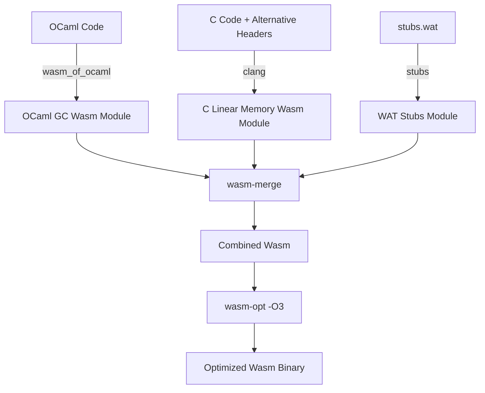

# Compiling and Linking C Code with Wasm_of_ocaml

This document outlines the current manual process for compiling C code and linking it with **wasm_of_ocaml**, and presents a design proposal for streamlining this workflow by modifying the compiler.

---

## Part 1: Current Implementation Strategy

Interfacing OCaml and C in a WebAssembly GC environment is different from a traditional native target due to partitioned memory spaces (the WebAssembly GC heap vs flat linear memory) and different value representation formats.

### 1. Architectural Overview

1. **Memory Spaces**: WebAssembly GC values live on the Wasm engine's garbage-collected heap. Standard C pointer operations can only target WebAssembly **linear memory**.
2. **Type representation**: `wasm_of_ocaml` uses WebAssembly GC reference types (`eqref`, `$block`, `$bytes`) internally. C code compiled with Clang represents opaque host values as `externref` (`__externref_t`).
3. **The Adapter Layer**: We bridge the gap using an alternative `caml/mlvalues.h` header on the C side and hand-written WebAssembly Text (WAT) stubs to convert types and copy buffers.



---

### 2. The Alternative C Headers (`caml/mlvalues.h`)

Since C code cannot read the GC heap directly, we redefine standard OCaml C binding macros to invoke imported helper functions.

```c
#ifndef CAML_MLVALUES_H
#define CAML_MLVALUES_H

#include <stddef.h>

/* OCaml values are represented as opaque WebAssembly external references */
typedef __externref_t value;

/* Primitive conversions */
value caml_val_int(int i);
int caml_int_val(value v);
value caml_val_double(double d);
double caml_double_val(value v);

#define Val_int(x) caml_val_int(x)
#define Int_val(x) caml_int_val(x)
#define Val_double(x) caml_val_double(x)
#define Double_val(x) caml_double_val(x)

#define Val_true caml_val_int(1)
#define Val_false caml_val_int(0)
#define Val_bool(x) caml_val_int((x) ? 1 : 0)
#define Bool_val(x) caml_int_val(x)

/* Block fields and Tags
 * Under wasm_of_ocaml, blocks are Wasm GC arrays where index 0 stores the tag
 * (as an i31ref) and the fields start at index 1.
 */
value caml_field(value v, int i);
void caml_store_field(value v, int i, value w);
int caml_tag_val(value v);

#define Field(v, i) caml_field(v, i)
#define Store_field(v, i, w) caml_store_field(v, i, w)
#define Tag_val(v) caml_tag_val(v)

/* Strings & Bytes
 * GC array characters must be copied to linear memory on demand.
 */
int caml_string_length(value v);
const char* caml_string_val(value v);
char* caml_bytes_val(value v);

#define String_val(v) caml_string_val(v)
#define Bytes_val(v) caml_bytes_val(v)

#endif /* CAML_MLVALUES_H */
```

---

### 3. Wasm GC Stubs (`stubs.wat`)

The WAT stub imports C functions, translates signatures between `(ref eq)` and `externref` types via conversion instructions, and implements GC operations.

```wat
(module
   ;; Import linear memory and allocators exported by the compiled C module
   (import "c_module" "c_memory" (memory 1))
   (import "c_module" "malloc" (func $malloc (param i32) (result i32)))
   
   ;; Import C functions that we want to wrap
   (import "c_module" "my_c_binding" (func $my_c_binding (param externref) (result externref)))

   ;; Wasm GC type definitions matching wasm_of_ocaml
   (type $float (struct (field $f f64)))
   (type $block (array (mut (ref eq))))
   (type $bytes (array (mut i8)))

   ;; Val_int: Int -> externref
   (func (export "caml_val_int") (param $i i32) (result externref)
      (extern.convert_any (ref.i31 (local.get $i))))

   ;; Int_val: externref -> Int
   (func (export "caml_int_val") (param $v externref) (result i32)
      (i31.get_s (ref.cast (ref i31) (any.convert_extern (local.get $v)))))

   ;; Field Access: returns field (i + 1) because index 0 is reserved for the tag
   (func (export "caml_field") (param $v externref) (param $i i32) (result externref)
      (extern.convert_any
         (array.get $block
            (ref.cast (ref $block) (any.convert_extern (local.get $v)))
            (i32.add (local.get $i) (i32.const 1)))))

   ;; Store Field: sets field (i + 1)
   (func (export "caml_store_field") (param $v externref) (param $i i32) (param $w externref)
      (array.set $block
         (ref.cast (ref $block) (any.convert_extern (local.get $v)))
         (i32.add (local.get $i) (i32.const 1))
         (any.convert_extern (local.get $w))))

   ;; String Copying: Copy GC bytes into C linear memory, returns pointer
   (func (export "caml_string_val") (param $v externref) (result i32)
      (local $len i32) (local $addr i32) (local $i i32) (local $bytes_ref (ref $bytes))
      (local.set $bytes_ref (ref.cast (ref $bytes) (any.convert_extern (local.get $v))))
      (local.set $len (array.len (local.get $bytes_ref)))
      (local.set $addr (call $malloc (i32.add (local.get $len) (i32.const 1))))
      (local.set $i (i32.const 0))
      (block $done
         (loop $loop
            (br_if $done (i32.eq (local.get $i) (local.get $len)))
            (i32.store8
               (i32.add (local.get $addr) (local.get $i))
               (array.get_u $bytes (local.get $bytes_ref) (local.get $i)))
            (local.set $i (i32.add (local.get $i) (i32.const 1)))
            (br $loop)))
      (i32.store8 (i32.add (local.get $addr) (local.get $len)) (i32.const 0))
      (local.get $addr))

   ;; OCaml Primitive Bridge wrapper: maps signatures
   (func (export "caml_my_c_binding") (param $v (ref eq)) (result (ref eq))
      (ref.cast (ref eq)
         (any.convert_extern
            (call $my_c_binding
               (extern.convert_any (local.get $v))))))
)
```

---

### 4. Compilation and Linking Commands

1. **Compile C Code**:
   ```bash
   /opt/wasi-sdk/bin/clang -O3 -flto \
     -nodefaultlibs -nostartfiles -ffreestanding \
     -mbulk-memory -mreference-types \
     -Wl,--no-entry \
     -Wl,--export-memory=c_memory \
     my_bindings.c -o c_module.wasm
   ```
2. **Compile OCaml Code**:
   ```bash
   wasm_of_ocaml --target=wasm -o ocaml_module.wasm main.ml
   ```
3. **Merge and Link Wasm Modules**:
   ```bash
   wasmoo_link_wasm.exe \
     -o app.wasm \
     c_module:c_module.wasm \
     stubs:stubs.wat \
     ocaml_module:ocaml_module.wasm
   ```

---

## Part 2: Proposed Compiler Streamlining

Writing manual WAT stubs for every external function is tedious. We propose modifications to `wasm_of_ocaml` to automate this workflow.

### 1. Automatic Wrapper Generation (Auto-Stubs)

Instead of manual stub files, we can modify the compiler to generate marshaling wrappers directly during compiling. To maximize compatibility with existing C bindings written for the regular OCaml compiler, the auto-generated wrappers will retain the use of OCaml's `value` type (represented as `externref` in WebAssembly) rather than unboxing arguments to standard C types.

For every OCaml declaration:
```ocaml
external my_c_function : int -> string -> float -> unit = "my_c_function"
```
The compiler can automatically output the correct wrapper function:
- Converts all OCaml GC values (e.g., `i31ref`, `$float` structs, GC arrays) into opaque Wasm `externref` values.
- Invokes the corresponding C function, which accepts and returns `externref` (typedef'd as `value` in the alternative C headers).
- Restores the Wasm GC type from the returned `externref` before yielding execution back to OCaml.

This approach ensures that existing C code utilizing standard macros (`Int_val`, `Double_val`, `String_val`) requires minimal to no modifications to be compiled for WebAssembly.

### 2. Built-in C-API Bridge Runtime

Instead of requiring developers to include helper implementations (`caml_field`, `caml_alloc`) in their stubs, `wasm_of_ocaml` should integrate them directly into the runtime (`runtime/wasm/obj.wat` and `gc.wat`).
- A single static `caml/mlvalues.h` file can then be shipped with `wasm_of_ocaml` and reused across all projects without modifications.
- Standard C bindings can be compiled directly against these runtime helper exports.

### 3. Integrated Tooling Integration

Extend the `wasm_of_ocaml` CLI to invoke clang and link the compiled linear memory output directly:
```bash
wasm_of_ocaml main.ml --link-c-file=my_bindings.c -o app.wasm
```
Under the hood, the compiler CLI will find `clang` (from the WASI-SDK), run the compilation with the proper flags (LTO, Reference Types), and bundle everything via `wasm-merge` automatically.

---

## Part 3: ABI Compatibility and Runtime Integration

To maintain seamless compatibility with standard C bindings, the design relies heavily on WebAssembly's native features and the existing `wasm_of_ocaml` Wasm runtime.

### 1. Memory Management for Strings and Bytes
Because C code written for the OCaml C-ABI expects strings to be managed by the GC (and potentially moved), it does not attempt to `free()` them. To support this in Wasm linear memory:
- Auto-generated wrappers will utilize a **scoped bump-allocator** (or shadow stack) in Wasm linear memory to copy GC string data.
- The wrapper allocates linear memory, passes the pointer to the C function, and immediately resets the bump-allocator's stack pointer after the C function returns.
- This safely provides C with a temporary linear memory pointer without causing memory leaks.

### 2. GC Roots and `CAMLparam` / `CAMLlocal`
WebAssembly GC automatically traces `externref` variables that are held on the Wasm execution stack or within locals. Therefore, the `caml/mlvalues.h` header for WebAssembly will redefine the `CAMLparam`, `CAMLlocal`, and `CAMLreturn` macros as **empty no-ops**. This drastically simplifies C compilation and completely eliminates manual GC root tracking overhead.

### 3. Callbacks and Exceptions
Operations like invoking closures (`caml_callback`) and raising exceptions (`caml_failwith`) do not require new Wasm GC stubs. These functions are already implemented natively within the `wasm_of_ocaml` runtime (`runtime/wasm/`). 
The C module simply imports these existing functions from the Wasm runtime environment. When C code calls `caml_callback(closure_val, arg_val)`, it passes the `externref` arguments to the runtime, which handles the Wasm GC unboxing and execution automatically.

---

## Part 4: Custom Blocks and Finalization

Custom blocks in OCaml are often used to wrap C pointers and attach finalization functions that `free` underlying resources when the block is garbage collected. Supporting this in WebAssembly GC introduces specific challenges, primarily because native Wasm GC **does not currently support finalizers**.

### 1. Representation and Faking the Finalizer Token
Since the custom C struct must live in Wasm linear memory, `caml_alloc_custom` generates a Wasm GC object (acting as the block) that stores an `i32` linear memory pointer and a pointer to the `custom_operations` struct. `Data_custom_val(v)` simply unboxes this Wasm GC object to return the `i32` payload.

To implement finalization, the runtime relies on the host JavaScript `FinalizationRegistry` as a fallback:
1. **Registration:** During allocation, the JS host registers the Wasm GC object with the `FinalizationRegistry`. Because the JS registry does not provide access to the collected object in its callback (the object is already dead), the host passes the raw `i32` linear memory pointer and `custom_operations` pointer as the registry's "held value" token.
2. **Reconstruction:** When the JS callback fires, it receives these `i32` pointers. Because standard C finalization functions expect an `externref` (`value v`), the JS runtime **allocates a dummy Wasm GC object** containing these exact same pointers.
3. **Execution:** This dummy object is cast to an `externref` and passed to the C `finalize` function. The C code successfully reads the linear memory pointer via `Data_custom_val(v)`, frees the memory, and returns. The dummy object is then quickly garbage collected. This completely hides the underlying JavaScript limitations from the C code.

### 2. The Memory Pressure Disconnect (Warning)
While `FinalizationRegistry` works as a best-effort mechanism, developers must be warned about **memory pressure**. 
The JS engine's garbage collector manages the small Wasm GC objects, but it is unaware of the potentially massive Wasm linear memory allocations they represent. A Wasm module can easily exhaust its linear memory (triggering an OOM crash) before the JS engine feels enough memory pressure to run a GC sweep and trigger the finalizers. 
When targeting WebAssembly with C bindings, developers should ideally provide explicit resource-release functions rather than relying strictly on the GC to clean up heavy linear memory allocations.

---

## Part 5: Primitive Resolution (OCaml Externals vs C Functions)

OCaml's `external` keyword is traditionally used both to bind to internal runtime primitives and to bind to user-defined C functions. Since `wasm_of_ocaml` relies heavily on internal Wasm runtime implementations (e.g., in `runtime/wasm/`), the compiler requires a deterministic mechanism to decide whether to link an `external` directly to the runtime or to generate a Wasm-to-C marshaling stub.

To maintain maximum compatibility without requiring code modifications (like adding `[@@wasm.c_stub]` annotations to every external), `wasm_of_ocaml` utilizes **Export Scanning**:

1. **Pre-compilation of C Code:** When developers pass C files via the `--link-c-file` CLI flag, `wasm_of_ocaml` leverages `clang` to compile the C code into a linear memory Wasm module *before* finalizing the OCaml compilation.
2. **Export Inspection:** The compiler inspects the exported symbols of the resulting C Wasm module. 
3. **Resolution Strategy:**
   - If an OCaml `external` declaration matches a symbol exported by the C Wasm module, the compiler identifies it as a user C function and **auto-generates the marshaling stub** (as described in Part 2).
   - If the symbol is not exported by the C module, the compiler assumes it is an internal `wasm_of_ocaml` runtime primitive and links it directly.

This approach guarantees high precision (no silent fallbacks or manual annotations required) and ensures that existing OCaml-C bindings compile out of the box with zero source code changes.

---

## Part 6: Known Limitations and Open Challenges

While the architecture outlined above aims for maximum compatibility, there are a few strict departures from the native OCaml C-ABI caused by WebAssembly constraints.

### 1. The `Bytes` Mutation Problem
In standard OCaml, C code is allowed to mutate `Bytes` objects in place via `Bytes_val(v)`. Because our Wasm GC auto-stubs copy the string/bytes buffer into a temporary linear memory bump allocator, any mutations the C code makes are applied to that temporary copy and lost when the function returns.
- **Proposed Mitigation:** Introduce an explicit `caml_mark_bytes_dirty(v)` macro to the WebAssembly C-API. If C code modifies a buffer, it must call this macro to signal the wrapper to copy the linear memory bytes back into the Wasm GC array after the C function returns.

### 2. `Field` and `Byte` as L-Values
According to the OCaml C-ABI, expressions like `Field(v, n)` and `Byte(v, n)` are valid C l-values (e.g., `Field(v, 0) = x;`). 
- **The Issue:** Because Wasm GC fields cannot be accessed via direct C pointer arithmetic, these macros must expand to imported function calls (e.g., `caml_field(v, n)`). In C, function calls are r-values, so assigning to them causes a C compilation error (`expression is not assignable`).
- **Migration Requirement:** Developers porting C code to WebAssembly must mechanically replace l-value assignments with the provided `Store_field(v, n, x)` and `caml_store_byte(v, n, x)` macros.

### 3. Persistent Pointers to Strings
Because strings and bytes are passed to C using a scoped bump allocator, any pointer returned by `String_val(v)` becomes a **dangling pointer** as soon as the C function returns. C code cannot store these interior pointers in global variables or inside custom blocks to be read later.

### 4. Multicore and Threading
OCaml 5 introduces Multicore support, but the current WebAssembly GC specification does not support sharing GC objects across threads (Shared Wasm GC is still an active proposal). This linking strategy strictly assumes a single-threaded WebAssembly execution environment.

### 5. Bigarrays and Linear Memory
Traditionally, JS-based runtimes implement Bigarrays as independent JavaScript `TypedArray`s. However, C code compiled to WebAssembly can only dereference pointers within its own specific Wasm linear memory.
- **The Design Shift:** To support passing Bigarrays to C without incurring massive copying overhead, `wasm_of_ocaml` must implement `Bigarray.create` by allocating space directly within the imported Wasm linear memory (using `$malloc`). `Caml_ba_data_val(v)` then simply yields this `i32` linear memory pointer.
- **Limitation 1 (Memory Pressure):** Like custom blocks, these massive linear memory allocations are tied to small Wasm GC objects. Relying on the JavaScript GC to collect the Wasm GC object and trigger the finalizer to `$free` the array is dangerous and can easily lead to linear memory exhaustion.
- **Limitation 2 (JavaScript Interop):** Existing projects often pass Bigarrays to JavaScript APIs (like WebGL). Moving Bigarrays into the Wasm linear memory means JS code must now access them by creating `TypedArray` views over the exported Wasm `memory.buffer`. If the Wasm memory dynamically grows, these JS `ArrayBuffer` views become detached and must be carefully recreated by the interop layer.
