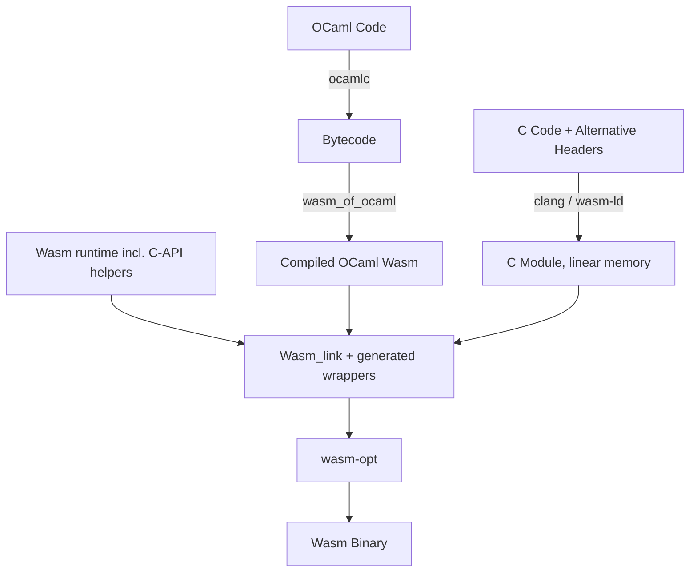

# Compiling and Linking C Code with Wasm_of_ocaml

This document describes the building blocks that `wasm_of_ocaml` already has for linking C code, the manual process that can be assembled from them, and a design proposal for supporting existing OCaml C bindings with little or no source change.

---

## Part 1: Starting Point

Interfacing OCaml and C in a WebAssembly GC environment differs from a native target: memory is partitioned (the Wasm GC heap vs. flat linear memory) and values are represented differently.

### 1. Architectural Overview

1. **Memory Spaces**: WebAssembly GC values live on the engine's garbage-collected heap. C pointer operations can only target WebAssembly **linear memory**.
2. **Type representation**: `wasm_of_ocaml` uses WebAssembly GC reference types (`(ref eq)`, `$block`, `$bytes`) internally. C code compiled with Clang represents opaque host values as `externref` (`__externref_t`).
3. **The Adapter Layer**: The gap is bridged by an alternative `caml/mlvalues.h` header on the C side and by Wasm helpers that convert types and copy buffers.

The partitioning is the source of most constraints in this document, but it is also a safety property: a memory bug in C code cannot corrupt the OCaml heap, since every access to a GC value goes through a typed helper that traps on misuse. It is confined to linear memory. How far it is confined depends on a design choice discussed in Part 2.4: if user C code shares the runtime's linear memory (one `malloc`, one libc), a buffer overflow in user code can still corrupt the C state of the runtime (its zstd and blake2 buffers) or of other C libraries.

### 2. What Already Exists

Several pieces of the pipeline are already in the repository:

- **The runtime links C code.** `runtime/wasm/c/` holds C sources (the zstd decoder, blake2, and a small libc layer for WASI) compiled with the WASI SDK into `c-impl.wasm` (freestanding, non-WASI runtime) and `libc.wasm` (WASI runtime, linked against wasi-libc). The `.wat` runtime modules import from them (e.g. `blake2.wat` imports the memory and the `blake2_*` functions). All C code of a runtime shares a single linear memory.
- **Our own Wasm linker.** The runtime and the compiled code are linked with `Wasm_link`, not `wasm-merge`. `wasmoo_link_wasm`, which the runtime build uses with `NAME:FILE` inputs (`c:c-impl.wasm`), is an internal tool: it is not installed.
- **Extra runtime files on the command line.** `wasm_of_ocaml` already accepts `.wat`, `.wast` and `.wasm` files next to the bytecode (`compile.ml`, `with_runtime_files` / `link_runtime`). They are linked into the runtime under the module name `env`. Dune passes them through the `(wasm_of_ocaml (wasm_files ...))` field.
- **Missing-primitive handling.** At link time, primitives used by the program but provided by no runtime module are computed (`Link.compute_missing_primitives`) and given stubs that raise (`generate_missing_primitives`).
- **Precompiled runtimes with a fallback.** The runtime is precompiled for the common flag combinations (`Runtime_files.precompiled_runtimes`); for any other combination it is built from its sources at link time (`build_runtime`).

Nothing below is shipped yet: there is no installed `caml/mlvalues.h`, no C-API helper module, and no way to give a user C module a module name of its own.



---

### 3. The Alternative C Headers (`caml/mlvalues.h`)

Since C code cannot read the GC heap directly, the standard OCaml C binding macros are redefined to call imported helper functions.

```c
#ifndef CAML_MLVALUES_H
#define CAML_MLVALUES_H

#include <stddef.h>
#include <stdint.h>

/* OCaml values are represented as opaque WebAssembly external references */
typedef __externref_t value;

/* Same auxiliary types as the native headers (32-bit on wasm32), so that
 * bindings using intnat / mlsize_t compile unchanged. Note that OCaml ints
 * are 31-bit under wasm_of_ocaml today (see Part 6.8). */
typedef int32_t intnat;
typedef uint32_t uintnat;
typedef uintnat mlsize_t;
typedef unsigned int tag_t;

/* "stubs" is the name of the C-API interface. The linker resolves these
 * imports to the helpers provided by the runtime (Part 2.3). */
#define CAML_HELPER __attribute__((import_module("stubs")))

/* Primitive conversions */
CAML_HELPER value caml_val_int(intnat i);
CAML_HELPER intnat caml_int_val(value v);
CAML_HELPER value caml_val_double(double d);
CAML_HELPER double caml_double_val(value v);

#define Val_long(x) caml_val_int(x)
#define Long_val(x) caml_int_val(x)
#define Val_int(x) caml_val_int(x)
#define Int_val(x) caml_int_val(x)
#define Val_double(x) caml_val_double(x)
#define Double_val(x) caml_double_val(x)

#define Val_unit caml_val_int(0)
#define Val_true caml_val_int(1)
#define Val_false caml_val_int(0)
#define Val_bool(x) caml_val_int((x) ? 1 : 0)
#define Bool_val(x) caml_int_val(x)

/* Tests and comparisons.
 * Clang rejects ==, ! and every other operator on __externref_t, so the
 * native bit tests and comparisons such as `v == Val_none` must go through
 * helpers (see Part 6.2). */
CAML_HELPER int caml_is_block(value v);
CAML_HELPER int caml_phys_eq(value v, value w); /* ref.eq */

#define Is_block(v) caml_is_block(v)
#define Is_long(v) (!caml_is_block(v))
#define Val_none Val_int(0)
#define Is_none(v) Is_long(v)
#define Is_some(v) Is_block(v)
#define Some_val(v) Field(v, 0)

/* Block fields and Tags
 * Under wasm_of_ocaml, blocks are Wasm GC arrays where index 0 stores the tag
 * (as an i31ref) and the fields start at index 1. Tag_val also handles
 * values that are not $block arrays (strings, floats, custom blocks, ...).
 */
CAML_HELPER value caml_field(value v, mlsize_t i);
CAML_HELPER void caml_store_field(value v, mlsize_t i, value w);
CAML_HELPER tag_t caml_tag_val(value v);
CAML_HELPER mlsize_t caml_wosize_val(value v);

#define Field(v, i) caml_field(v, i)
#define Store_field(v, i, w) caml_store_field(v, i, w)
#define Tag_val(v) caml_tag_val(v)
#define Wosize_val(v) caml_wosize_val(v)

/* Flat float arrays are a distinct Wasm GC type; Field/Store_field are
 * invalid on them (see Part 6.4).
 */
CAML_HELPER double caml_double_field(value v, mlsize_t i);
CAML_HELPER void caml_store_double_field(value v, mlsize_t i, double d);

#define Double_field(v, i) caml_double_field(v, i)
#define Store_double_field(v, i, d) caml_store_double_field(v, i, d)

/* Strings & Bytes
 * GC array contents are copied to linear memory on demand, at most once per
 * value and per C call; modified buffers are copied back when the C
 * function returns (see Part 3.1).
 */
CAML_HELPER mlsize_t caml_string_length(value v);
CAML_HELPER const char* caml_string_val(value v);
CAML_HELPER char* caml_bytes_val(value v);

#define String_val(v) caml_string_val(v)
#define Bytes_val(v) caml_bytes_val(v)

/* This header is an excerpt. The full header additionally covers
 * allocation (caml_alloc, caml_alloc_tuple, caml_copy_string,
 * caml_copy_double, ...), caml_stat_alloc / caml_stat_free (mapped to
 * linear-memory malloc / free), exceptions, callbacks, etc.
 */

#endif /* CAML_MLVALUES_H */
```

---

### 4. Wasm GC Helpers

The helpers translate between `(ref eq)` and `externref` and implement GC operations. Written by hand, a stub module looks as follows; Part 2.3 moves these helpers into the runtime and Part 2.2 generates the per-primitive wrappers.

```wat
(module
   ;; Import linear memory and allocators exported by the compiled C module
   (import "c_module" "c_memory" (memory 1))
   (import "c_module" "malloc" (func $malloc (param i32) (result i32)))

   ;; Import C functions that we want to wrap
   (import "c_module" "my_c_binding" (func $my_c_binding (param externref) (result externref)))

   ;; Wasm GC type definitions matching wasm_of_ocaml (runtime/wasm/obj.wat)
   (type $float (struct (field $f f64)))
   (type $block (array (mut (ref eq))))
   (type $bytes (array (mut i8)))

   ;; Val_int: Int -> externref
   (func (export "caml_val_int") (param $i i32) (result externref)
      (extern.convert_any (ref.i31 (local.get $i))))

   ;; Int_val: externref -> Int
   (func (export "caml_int_val") (param $v externref) (result i32)
      (i31.get_s (ref.cast (ref i31) (any.convert_extern (local.get $v)))))

   ;; Val_double: f64 -> externref
   (func (export "caml_val_double") (param $d f64) (result externref)
      (extern.convert_any (struct.new $float (local.get $d))))

   ;; Double_val: externref -> f64
   (func (export "caml_double_val") (param $v externref) (result f64)
      (struct.get $float $f (ref.cast (ref $float) (any.convert_extern (local.get $v)))))

   ;; Field Access: returns field (i + 1) because index 0 is reserved for the tag
   (func (export "caml_field") (param $v externref) (param $i i32) (result externref)
      (extern.convert_any
         (array.get $block
            (ref.cast (ref $block) (any.convert_extern (local.get $v)))
            (i32.add (local.get $i) (i32.const 1)))))

   ;; Store Field: sets field (i + 1)
   (func (export "caml_store_field") (param $v externref) (param $i i32) (param $w externref)
      (array.set $block
         (ref.cast (ref $block) (any.convert_extern (local.get $v)))
         (i32.add (local.get $i) (i32.const 1))
         (ref.cast (ref eq) (any.convert_extern (local.get $w)))))

   ;; String Copying: Copy GC bytes into C linear memory, returns pointer
   ;; WARNING: This hand-written version allocates with malloc and never frees
   ;; the copy. The proposed design uses a scoped bump allocator (Part 3.1).
   ;; There is no bulk instruction between GC arrays and linear memory, hence
   ;; the byte loop (see Part 8.3).
   (func (export "caml_string_val") (param $v externref) (result i32)
      (local $len i32) (local $addr i32) (local $i i32) (local $bytes_ref (ref $bytes))
      (local.set $bytes_ref (ref.cast (ref $bytes) (any.convert_extern (local.get $v))))
      (local.set $len (array.len (local.get $bytes_ref)))
      (local.set $addr (call $malloc (i32.add (local.get $len) (i32.const 1))))
      (local.set $i (i32.const 0))
      (block $done
         (loop $loop
            (br_if $done (i32.eq (local.get $i) (local.get $len)))
            (i32.store8
               (i32.add (local.get $addr) (local.get $i))
               (array.get_u $bytes (local.get $bytes_ref) (local.get $i)))
            (local.set $i (i32.add (local.get $i) (i32.const 1)))
            (br $loop)))
      (i32.store8 (i32.add (local.get $addr) (local.get $len)) (i32.const 0))
      (local.get $addr))

   ;; OCaml primitive wrapper: maps signatures. The generated wrappers of
   ;; Part 2.2 also restore the C stack and bump pointers, copy buffers back,
   ;; and handle exceptions.
   (func (export "caml_my_c_binding") (param $v (ref eq)) (result (ref eq))
      (ref.cast (ref eq)
         (any.convert_extern
            (call $my_c_binding
               (extern.convert_any (local.get $v))))))
)
```

---

### 5. Compiling the C Code

```bash
/opt/wasi-sdk/bin/clang -O3 -flto \
  -mbulk-memory -mreference-types \
  -mexec-model=reactor \
  -Wl,--allow-undefined \
  -Wl,--export-memory=c_memory \
  -Wl,--export=malloc -Wl,--export=free \
  -Wl,--export=my_c_binding \
  -Wl,--export=__stack_pointer \
  -Wl,--export-table \
  my_bindings.c -o c_module.wasm
```

- The WASI SDK links **wasi-libc** by default, so `malloc`, `string.h`, etc. are available. `-mexec-model=reactor` builds a library-style module, with an `_initialize` entry point instead of `_start`. The module's WASI imports (`wasi_snapshot_preview1.*`) must be satisfied: in the WASI runtime by the host, otherwise by a shim or by trivial stubs when the bindings perform no I/O.
- **Every function called from outside must be exported explicitly.** In reactor mode, and with `-flto`, a function that is neither exported nor reachable from an export is removed: without `--export=my_c_binding` (or `__attribute__((export_name(...)))`), the module above exports only `c_memory`, `_initialize` and `malloc`.
- `__stack_pointer` and the function table (`__indirect_function_table`) are exported for the wrappers (Part 3.3) and for custom block operations (Part 4).
- `-Wl,--allow-undefined` is required because the C code imports the `caml_*` helpers; the header declares them with `import_module("stubs")`.
- **`_initialize` must be called before any other export**: it runs libc initialization and C constructors. Neither `wasm-merge` nor our linker does that on its own; the generated start function (`Link.generate_start_function`) has to call it.

Today there is no supported way to link the result: the command-line runtime files all get the module name `env`, so the stubs' imports from `c_module` cannot be resolved, and `wasmoo_link_wasm` is internal. Part 2.1 closes this gap.

---

## Part 2: Proposed Compiler Support

Writing WAT stubs for every external function is tedious and error-prone. The proposal below automates the workflow, building on the pieces of Part 1.2.

### 1. Accept C Modules as Runtime Files

The first step is small: let the command line (and dune's `wasm_files`) give a linked C module a module name, as `wasmoo_link_wasm` already does with `NAME:FILE`, or recognize C modules (they import from `stubs`) and name them automatically. The linker resolves their `stubs` imports to the runtime's helpers and calls their `_initialize` from the start function. This alone makes the manual flow of Part 1 work with hand-written stubs.

### 2. Automatic Wrapper Generation

Instead of hand-written stubs, the compiler generates a wrapper for each primitive implemented in C. To stay compatible with existing C bindings, the wrappers keep OCaml's `value` type (`externref`) rather than unboxing arguments to C types.

For a declaration:
```ocaml
external my_c_function : int -> string -> float -> unit = "my_c_function"
```
the generated wrapper:
- converts its `(ref eq)` arguments to `externref` (a free conversion);
- saves the C module's `__stack_pointer` and the bump-allocator pointer;
- calls the C function inside a `try_table` with a `catch_all` handler;
- on return, copies modified `Bytes`/`String` buffers back to the GC heap (Part 3.1), restores both pointers and converts the result back to `(ref eq)`;
- on an exception, restores both pointers and rethrows (Part 3.3).

The wrappers are generated at link time, in place of the raising stubs that the linker currently generates for missing primitives (Part 5): compiled OCaml code imports the primitive as it does today and does not need to know that it is implemented in C.

Existing C code using the standard macros (`Int_val`, `Double_val`, `String_val`) then needs few or no changes; Part 6 lists the cases that do need changes.

### 3. C-API Helpers in the Runtime

The helpers (`caml_field`, `caml_alloc`, `caml_string_val`, ...) are provided by the runtime (`runtime/wasm/`) rather than by each project, so that a single `caml/mlvalues.h` can be shipped with `wasm_of_ocaml` and reused unchanged.

This includes callbacks and exceptions. The existing runtime functions cannot be imported by C code as they are: they take `(ref eq)` rather than `externref`, and the C API passes strings as linear-memory pointers (`caml_failwith(const char *)` must copy its argument into a GC string). Each needs a thin adapter; Part 3.3 covers the cases that need more than a type conversion.

### 4. Linking C Libraries in a Single Step

The runtime already shares one linear memory between all its C code. Linking independently linked C modules side by side gives duplicate symbols: several copies of libc, several `malloc`s, and heaps that cannot exchange pointers. This applies between user libraries, and also between user code and the runtime's own C code.

The toolchain should therefore collect *all* C objects and archives, the runtime's included, and perform a **single `wasm-ld` link** with one libc and one allocator. This changes how the runtime's C code is shipped: today it is linked into `c-impl.wasm` / `libc.wasm` and promoted into the source tree; it would instead be shipped as object files (or an archive) and linked at program link time when user C code is present. Keeping one module per library remains an option for isolation (the multi-memory proposal makes it principled), at the cost of the shared heap.

The command-line form is:
```bash
wasm_of_ocaml main.byte --link-c-file=my_bindings.c -o main.js
```
`wasm_of_ocaml` finds `clang` (from the WASI SDK), compiles with the flags of Part 1.5, and performs the single link. The flag must be accepted both by the whole-program `compile` subcommand and by the separate-compilation `link` subcommand (used by dune's dev profile), since primitive resolution happens at link time in the latter mode.

### 5. Build System Integration (dune / findlib)

A `--link-c-file` flag assumes the user lists C files by hand, but the information already exists: dune's `(foreign_stubs ...)` stanzas, and the `dllibs` and primitives recorded in `.cma` files. Dune already passes per-library `.wat`/`.wasm` runtime files through `(wasm_of_ocaml (wasm_files ...))`; extending this to C objects (or compiling `foreign_stubs` with the WASI SDK in a Wasm context) would make linking a Wasm executable pick up C stubs transitively, as native linking does. Without it, existing bindings only work for whoever writes the link command by hand; this is likely the largest remaining gap for adoption.

### 6. Portable Prebuilt Binding Artifacts

Compiled Wasm C code is architecture-independent, unlike a native `.o`. A package like `zarith` can build its C code (GMP included) once in CI and ship it in its opam package; downstream users then need no WASI SDK and no clang. For the single link of Part 2.4, what is shipped must be linkable: wasm32 object files or archives, not a linked module. LTO bitcode is tied to an LLVM version, so prebuilt artifacts should be regular object files.

---

## Part 3: ABI Compatibility and Runtime Integration

### 1. Strings and Bytes

C code written for the OCaml C API does not `free()` the pointers returned by `String_val` / `Bytes_val`. The wrappers therefore copy GC string data into a **scoped bump allocator** in linear memory, which is reset when the C function returns.

- **One copy per value and per call.** Each `String_val(v)` call would otherwise copy the whole string: loops such as `for (...) String_val(s)[i]`, or the `Byte(v, i)` macro, would become quadratic and could overflow the bump region. The helper keeps a per-frame table from GC values (compared with `ref.eq` on the GC side) to their copies and returns the existing copy.
- **Copy-back.** At the end of the call, the wrapper compares each copy with the GC array and writes back the bytes that differ. This covers `Bytes_val`, and also the common idiom of writing through `String_val` on a freshly allocated string (`r = caml_alloc_string(n); memcpy((char *)String_val(r), buf, n);`), which is undefined behaviour natively but widespread in older bindings. The comparison costs about as much as the copy.
- **Large buffers.** Copying is proportional to the buffer, not to the accessed range: `memcpy(Bytes_val(b) + ofs, src, len)` into a large buffer (a `read`-style binding) copies the whole buffer in and compares it out on every call. A `caml_bytes_sub(v, ofs, len)` accessor, which copies only a range, is the opt-in fix for such hot paths.
- **Callbacks.** If C code calls back into OCaml while holding a copy, OCaml sees the bytes as they were before the C function started writing, and OCaml writes to the same bytes are overwritten by the copy-back when the C function returns. Bindings that share a buffer between C and a callback must flush explicitly (`caml_bytes_flush(v)`) before calling back and fetch the buffer again afterwards.
- **Capacity.** The bump region has a fixed size; larger copies fall back to `malloc`, tracked in the same per-frame table and freed when the frame is reset.

### 2. GC Roots and `CAMLparam` / `CAMLlocal`

The Wasm engine traces `externref` values held in Wasm locals and on the Wasm stack, so local roots need no registration. The macros are kept for scoping:
- **Macro redefinitions:** `CAMLparam` records the bump pointer and `CAMLreturn` / `CAMLreturn0` restore it (after copying back the frame's buffers), for frame-local cleanup.
- **Wrapper safety net:** functions that omit `CAMLparam`/`CAMLreturn` are covered by the wrapper of Part 2.2, which resets the bump pointer when the C function returns or raises.
- `CAMLlocalN(x, n)` declares an array of values, which cannot exist (Part 6.2); it is not supported.

### 3. Exceptions and Callbacks

`wasm_of_ocaml` primitives raise OCaml exceptions with the Wasm `throw` instruction (tag `ocaml_exception`), whether the exception is raised by OCaml code called back from C or by C code calling `caml_failwith` and the like. Clang-compiled C code without Wasm exception handling does not catch it: the exception unwinds through C frames.

- **The C stack pointer is not restored.** C code keeps a shadow stack in linear memory, addressed by the mutable global `__stack_pointer`. Unwinding skips the epilogues that pop C frames, so each exception raised through C code leaks the frames it crossed. With wasm-ld's default layout (stack first), repeated leaks end in an out-of-bounds trap; with `--no-stack-first` (as used by the runtime's own `c-impl.wasm`) the stack grows into static data and corrupts it silently. The wrapper of Part 2.2 therefore saves `__stack_pointer` before the call and restores it in its `catch_all` handler before rethrowing; the C module must export it (Part 1.5). The same handler resets the bump allocator.
- **Cleanup in C code is skipped.** `free()` calls and other resource releases in the frames crossed by an exception do not run. C code that holds resources around a callback should use `caml_callback_exn`, release them, and then re-raise. This does not help when the C code itself raises (`caml_failwith`): such code must release resources before raising, as it must natively.
- **Encoding `caml_callback_exn` results.** Natively, an exception result is a tagged pointer, tested with `Is_exception_result` and decoded with `Extract_exception`. There is no tag bit on an `externref`. The adapter catches the exception, stores it in a runtime slot and returns a distinguished sentinel object; `Is_exception_result(v)` tests for the sentinel with `ref.eq` and `Extract_exception(v)` reads (and clears) the slot.

### 4. Effects and C Frames

In native OCaml 5, an effect cannot be performed across C frames: an effect performed in a callback from C and not handled within that callback raises `Effect.Unhandled`. The same restriction is needed here, for every effects backend:
- with JSPI or native stack switching, suspending a continuation that contains C frames would leave those frames sharing the single C shadow stack and bump allocator with whatever code runs next, corrupting both;
- with CPS, C frames cannot be captured at all; the runtime's `caml_callback_N` already runs the closure to completion through `caml_cps_trampoline`.

The `caml_callback` adapters therefore run the closure under a barrier handler that turns any effect reaching it into `Effect.Unhandled`, as native OCaml does.

---

## Part 4: Custom Blocks and Finalization

Custom blocks are often used to wrap C pointers and attach finalization functions that free underlying resources. Wasm GC has **no finalizers**, so finalization goes through the JavaScript `FinalizationRegistry` (or, under WASI, is unavailable). Note that `Gc.finalise` is currently a no-op in the Wasm runtime (`gc.wat`, `caml_final_register`); the mechanism below would also implement it.

### 1. Representation

`caml_alloc_custom(ops, size, used, max)` allocates `size` bytes of payload with `malloc` in linear memory and returns a Wasm GC object holding the payload address and the address of the C `custom_operations` struct. `Data_custom_val(v)` returns the payload address.

- **Every custom block needs freeing, not just those with a finalizer.** Natively, the GC frees the block's payload along with the block. Here the payload is a `malloc`ed region, so every custom block allocated from C must be registered for finalization, whether or not its `ops` have a `finalize` function.
- **Operations are C function pointers**, i.e. indices into the C module's function table. The runtime calls `finalize`, `compare`, `hash`, `serialize` and `deserialize` with `call_indirect` through the exported `__indirect_function_table`. The runtime's own custom blocks use a `$custom_operations` struct of funcrefs; C custom blocks get a single bridge instance of it whose functions dispatch through the table, so that polymorphic comparison, `Hashtbl.hash` and `Marshal` work on them.

### 2. Finalization Through `FinalizationRegistry`

1. **Registration:** at allocation, the runtime registers the Wasm GC object with a `FinalizationRegistry`, with the payload address and the `custom_operations` address as the held value (the callback cannot see the collected object).
2. **Reconstruction:** when the callback fires, it calls a Wasm export of the runtime with these two addresses. JavaScript cannot allocate Wasm GC objects itself; the export allocates a stand-in custom block holding the same addresses.
3. **Execution:** the export calls the C `finalize` function (if any) on the stand-in, then frees the payload. The stand-in is garbage afterwards. The C code reads the payload with `Data_custom_val(v)` as usual.

### 3. Memory Pressure

Finalization is delayed:
1. the engine's GC must first find the Wasm GC object dead;
2. it then schedules the `FinalizationRegistry` callback;
3. the JavaScript event loop must yield before the callback runs and frees the payload.

The engine's GC heuristics see only the small Wasm GC object, not the linear memory it retains, and may not collect often enough: a program can exhaust its linear memory before finalizers run. Code allocating large resources through custom blocks should release them explicitly (e.g. a `close`/`free` function in the binding) rather than rely on finalizers. Long-running loops that never yield to the event loop never run finalizers at all.

Native OCaml already exposes the missing information: the `used` / `max` arguments of `caml_alloc_custom` tell the GC how much external memory a block retains. They are currently discarded under WebAssembly for lack of an engine API; they are what the `gc.adjust_external_memory` extension of Part 8 would consume.

---

## Part 5: Primitive Resolution (OCaml Externals vs C Functions)

OCaml's `external` binds both runtime primitives and user C functions. The linker must decide, for each primitive, which implementation to use and whether a C wrapper is needed.

### 1. Resolution at Link Time

Resolution uses **export scanning** at link time. The C code is linked first (Part 2.4); the exports of the resulting module are the candidate C implementations. Its imports (the `caml_*` helpers it consumes) are ignored by the scan. Primitives are then resolved as today, with C as an additional source: a primitive provided by no runtime module but exported by the C module gets a generated wrapper (Part 2.2) instead of a raising stub. Since this is the linker's existing missing-primitive step, it works the same in whole-program mode (`compile`) and in separate compilation (`link`): OCaml code generation is not affected.

### 2. Sources and Collisions

There are four sources of primitive implementations:
1. the Wasm runtime;
2. user `.wat` / `.wasm` runtime files (command line or dune `wasm_files`);
3. JavaScript primitives (`//Provides:` in JavaScript runtime files);
4. C code.

A primitive provided by several sources must not be resolved silently. The typical case is a library that ships both its original C sources and a hand-written Wasm implementation of some primitives. The proposed order is the one above, with a warning on each collision involving C code, and a command-line flag to prefer the C implementation of given primitives.

### 3. Externals with More than Five Arguments

For an external with more than five arguments, OCaml requires two C functions: a bytecode one, `foo_byte(value *argv, int argn)`, and a native one taking the arguments directly. `wasm_of_ocaml` works from bytecode, where only the bytecode name is recorded, but `foo_byte` cannot be called: arrays of values cannot exist in linear memory (Part 6.2). The wrapper must call the native function instead. Its name is not in the bytecode, but it is recorded with the external declaration (`Primitive.description.prim_native_name`, in the `.cmi` when the external is exported, and in the `.cmt` otherwise). Options, from most to least robust:
1. read native names from `.cmi`/`.cmt` files at compile time and record the bytecode-name → native-name mapping in the compiled unit;
2. let bindings give the mapping explicitly (an attribute on the external, or a table passed to the linker);
3. as a fallback, try common naming conventions (`foo_byte` / `foo_bytecode` → `foo` / `foo_native`) against the C module's exports, with a warning.

The `[@unboxed]` and `[@untagged]` attributes only change the native function's signature; the bytecode function always takes boxed values. For externals with at most five arguments, the wrapper calls the bytecode name and these attributes have no effect. For those with more, the native function's signature (from the declaration) tells the wrapper which arguments to unbox.

---

## Part 6: Known Limitations and Open Challenges

Some departures from the native OCaml C API are unavoidable under WebAssembly.

### 1. Writes Through String Pointers

Part 3.1 makes writes through both `Bytes_val` and `String_val` visible to OCaml when the C function returns. What remains different from native code:
- writes are visible to OCaml only at the end of the call, or at an explicit `caml_bytes_flush`;
- a `caml_bytes_readonly(v)` accessor skips the copy-back comparison for read-only hot paths; using it on a buffer that is then written loses the writes.
  * *Real-world case:* `mpfr__sprintf` in `mlgmpidl` (`mpfr.idl`) takes a `[string] char *STR` parameter and formats a float into it in place. It works unchanged with copy-back.

### 2. `__externref_t` Restrictions

OCaml's `value` is `externref` (`__externref_t`). Reference types cannot be stored in linear memory, and Clang restricts their use further. Clang 21 rejects:
- comparisons and other operators: `v == Val_unit`, `v == Val_none`, `!v` (use `caml_phys_eq`, `Is_long`, `Is_block`, `Is_none`, Part 1.3);
- struct fields of type `value` ("field has sizeless type") and arrays of values, including local ones;
- taking the address of a value (`&v`) and pointers to values (`value *`);
- `sizeof(value)`;
- passing a value to a variadic function.

Global variables of type `value` are accepted by the front end but make the backend crash ("Cannot select" on the store); they must be considered unsupported.

Consequences:
* **Structures and arrays** containing values (`struct s { value v; }`, `value args[10]`) do not compile.
* **`value *` APIs** do not compile: `caml_callbackN(value closure, int narg, value *args)`, `const value *caml_named_value(const char *)`, `caml_register_global_root(value *)`, `CAMLlocalN`, and the bytecode functions of externals with more than five arguments (Part 5.3).
* **Static caches** such as `static const value *exn = NULL; if (!exn) exn = caml_named_value("foo");` need rewriting. `caml_named_value` can be offered as a shim returning the value or a handle.
* **Workaround:** bindings that must store values outside locals use a handle API:
  ```c
  typedef int32_t caml_root; // Safe to store in linear memory
  caml_root caml_acquire_root(value v); // Allocates a slot in a Wasm table
  value caml_resolve_root(caml_root r); // Resolves the handle to the value
  void caml_release_root(caml_root r); // Frees the slot
  ```

### 3. `Field` and `Byte` as L-Values

In the OCaml C API, `Field(v, n)` and `Byte(v, n)` are l-values (`Field(v, 0) = x;`). Here they expand to helper calls, which are r-values: assignment fails to compile with `expression is not assignable`. Code must use `Store_field(v, n, x)` and `caml_store_byte(v, n, x)`. (Natively, assigning `Field` on a block outside the minor heap is already wrong without `caml_modify`; the change mostly affects initialization of fresh blocks.)

### 4. Flat Float Arrays

`float array` is a distinct Wasm GC type (`$float_array`, an `(array (mut f64))`), not a `$block`. `Field` / `Store_field` are invalid on it; C code must use `Double_field(v, i)` / `Store_double_field(v, i, d)`. This is the same rule as in native OCaml, but misuse traps with a cast failure instead of reinterpreting memory.

### 5. Pointers to String Copies

A pointer returned by `String_val(v)` or `Bytes_val(v)` is invalid once the C function returns, since the bump region is reset. This is not new: natively, the GC may move the string once the C function returns or allocates, so storing such pointers is already incorrect. What is new is that the pointer stays valid during the call but goes **stale**: after a callback into OCaml, the copy no longer reflects OCaml's changes to the string (Part 3.1).

### 6. Multicore and Threading

Wasm GC objects cannot be shared between threads (shared Wasm GC is still a proposal). The design assumes single-threaded execution, as does `wasm_of_ocaml` today.

### 7. Bigarrays and Linear Memory

The runtime has two Bigarray representations today: JavaScript typed arrays accessed through imported `DataView` functions (JavaScript runtime), and Wasm GC arrays (WASI runtime, `bigarray.wat`). C code can only dereference addresses in its own linear memory, so neither can be passed to C without copying.

- **Linear-memory Bigarrays:** when C code is linked, `Bigarray.create` allocates the data with `malloc` in the shared linear memory, and `Caml_ba_data_val(v)` returns its address.
  * *Real-world case:* `mpz__import` / `mpz__export` in `mlgmpidl`'s `mpz.idl` use `[bigarray]` to transfer digit arrays and rely on `Caml_ba_data_val` returning a usable address.
- **A third runtime variant.** This representation only applies when C code is linked, so builds without C keep the current ones. It is a new runtime configuration: it must either be added to the precompiled runtimes (doubling their number) or rely on the fallback that builds the runtime from its sources at link time, which works but slows down linking.
- **Performance of OCaml-side accesses** may improve (plain loads and stores instead of imported `DataView` calls) or not (engines can inline some well-known imports); this should be measured before being used as an argument.
- **Limitation 1 (memory pressure):** as for custom blocks (Part 4.3), large allocations held by small Wasm GC objects may not be freed in time.
- **Limitation 2 (address space):** wasm32 linear memory is limited to 4 GiB in total, for all Bigarrays and all C data, and it never shrinks: freed memory returns to `malloc`, not to the system.
- **Limitation 3 (JavaScript interop):** JavaScript code accessing Bigarrays (e.g. passing them to WebGL) must use typed-array views over the exported memory buffer. Growing the memory detaches those views, which must then be recreated by the interop layer; this also applies to any view the runtime itself keeps over the memory.
- **Limitation 4 (JS-to-OCaml transfer):** Bigarrays created from existing JavaScript typed arrays (`Typed_array` in the `js_of_ocaml` library) can no longer wrap the buffer in place; the data must be copied.

### 8. Integer Width

`intnat` is 32 bits on wasm32, while OCaml ints are 31 bits under `wasm_of_ocaml` (and 63 bits on native 64-bit platforms). `Val_long` of a value outside the 31-bit range wraps silently; bindings that rely on 63-bit ints (file offsets, sizes, hash values) break. If OCaml ints become 63 bits in `wasm_of_ocaml`, `intnat` should become 64 bits too; but C code commonly assumes that `intnat` and pointers have the same size, which would then no longer hold on wasm32. This choice should be settled before the header is shipped.

### 9. Porting and Debugging Tooling

Two tools would lower the porting cost:
- **A migration lint:** a libclang-based checker that scans C stub sources for the patterns above (comparisons of values, `value` fields or arrays, `value *` parameters, globals of type `value`, `Field(...) = x` l-values, `CAMLlocalN`, externals with more than five arguments without a known native name) and produces a porting report. Run over opam, it would also measure how much of the ecosystem fits the ABI as is.
- **A debug mode:** leaks through delayed finalization (Part 4.3), stale or dangling string pointers (Section 5 above) and writes lost through a mistaken `caml_bytes_readonly` (Section 1) all fail silently. A debug variant of `--link-c-file` could report custom block payloads still allocated at exit, poison the bump region after each reset so that use-after-return traps, and enable the WASI SDK's ASan / UBSan for the C side.

---

## Part 7: Architectural Models for `value` Representation

The C-side representation of `value` determines performance, root tracking, and compatibility with `value *`-based APIs.

### Model A: Reference Representation (Proposed)
```c
typedef __externref_t value;
```
`value` is a WebAssembly reference (`externref`).

* **Pros:**
  * **No lookup overhead:** values cross the boundary as Wasm values.
  * **Automatic local root tracking:** C locals of type `value` are Wasm locals, traced by the engine. `CAMLparam` / `CAMLlocal` / `CAMLreturn` register no roots (they are kept for bump-allocator scoping, Part 3.2).
* **Cons:** the restrictions of Part 6.2: no values in linear memory, no `value *`, no comparisons without helpers. `caml_named_value` can be shimmed; `caml_callbackN` and `caml_register_global_root` need the handle API.

### Model B: Handle Representation (Alternative)
```c
typedef int32_t value;
```
`value` is an index into a WebAssembly table holding the GC references.

* **Pros:**
  * **Pointer compatibility:** `value *`, values in structures, static arrays of values, and `==` comparisons of immediate values work.
  * **Compatible APIs:** `caml_named_value`, `caml_callbackN` and `caml_register_global_root` work as is.
* **Cons:**
  * **Lookup overhead:** every access resolves an index in the table.
  * **Mandatory root tracking:** `CAMLparam` / `CAMLlocal` / `CAMLreturn` must allocate and release table slots, or the table leaks; values not covered by these macros are unsafe. Comparisons of handles do not implement physical equality for blocks, since the same block can have several handles.

### Decision
This design adopts **Model A**, with the handle API of Part 6.2 as an opt-in for the bindings that must store values in linear memory. The common path has no table lookups and no root registration; `value *`-based code gets a mechanical porting recipe.

---

## Part 8: Desired WebAssembly Extensions

The current constraints force trade-offs (copying strings, delayed finalization). The following extensions would remove some of them. They are proposals for discussion, not features known to be planned.

### 1. External Memory Pressure Hints (`gc.adjust_external_memory`)
* **The problem:** the engine's GC heuristics see only the size of Wasm GC objects, not the linear memory that a custom block or Bigarray retains, so it may not collect often enough (Part 4.3).
* **The extension:** an instruction such as `gc.adjust_external_memory (param i32)` adding to or subtracting from a module-level counter of retained external memory, which the engine feeds into its GC heuristics.
* **Feasibility:** engines already have this mechanism internally for their own embedders (e.g. V8's `v8::Isolate::AdjustAmountOfExternalAllocatedMemory`), and a global counter does not change object layouts.

### 2. Prompt Wasm Finalizers
* **The problem:** `FinalizationRegistry` callbacks only run once the JavaScript event loop gets control, which can be too late for linear memory management, or never in a long computation.
* **The extension:** a post-sweep finalization queue. Finalizers do not run during GC; the engine queues them and runs them at well-defined points:
  * when the Wasm call stack is empty (at the end of the outermost call);
  * at explicit polling points (e.g. a `gc.poll_finalizers` instruction);
  * when a JSPI stack suspends.
* **Reentrancy:** running finalizers only at these points avoids running them in the middle of a Wasm function whose invariants they could break.

### 3. Bulk Copies Between GC Arrays and Linear Memory
* **The problem:** copying a string between a GC array and linear memory (Part 3.1) is a byte loop in Wasm; there is no equivalent of `memory.copy` or `array.copy` between the two.
* **The extension:** instructions copying a range of an `i8` array to linear memory and back. This has been discussed as a GC post-MVP feature and would make string copies close to `memcpy` speed.

---

## Part 9: Extending the Design to the JavaScript Target (`js_of_ocaml`)

Most of the design is target-independent. The C-facing surface is an ABI: an opaque `value`, the `caml_*` helpers imported from `stubs`, and copy-in/copy-out for strings and bytes. Nothing in it requires the helpers to be implemented in Wasm GC; they can be implemented in JavaScript, so the same C bindings would work with `js_of_ocaml`.

### 1. A Target-Independent C ABI

The C-side ABI (the alternative `caml/mlvalues.h` and the `stubs` import interface) should be **target-independent**, with two implementations of `stubs`:
- the Wasm implementation in the `wasm_of_ocaml` runtime (Part 2.3);
- a JavaScript implementation, supplied at instantiation time by `js_of_ocaml`.

The same compiled C code then serves both targets. Libraries like `zarith` or `mlgmpidl` get a single porting story, instead of the hand-written JavaScript reimplementations they require today.

### 2. Why the JavaScript Side Is Simpler

- **`externref` is a JS value.** In a Wasm module instantiated from JavaScript, `__externref_t` holds arbitrary JS values, with no conversion at the boundary.
- **Simple helpers.** `js_of_ocaml` blocks are JS arrays with the tag at index 0, the same layout as the Wasm GC representation: `caml_field(v, i)` is `v[i + 1]`, `caml_tag_val(v)` is `v[0]`, and `caml_val_double` is the identity. The bump allocator and the copy-back of Part 3.1 operate on the C module's exported memory.
- **Existing machinery transfers.** Callbacks, exceptions, custom blocks (`FinalizationRegistry` is directly available) and link-time resolution (Part 5) carry over. JS exceptions unwind through Wasm C frames as Wasm exceptions do, so the wrappers must restore `__stack_pointer` and the bump pointer in the same way (Part 3.3); the effect barrier of Part 3.4 applies too.
- **Representation differences are absorbed by the helpers.** JS strings vs. `MlBytes`, `MlInt64` for int64, etc. are handled inside the helpers. Ints are 32 bits in `js_of_ocaml`, which matches `intnat` on wasm32.

### 3. Costs Specific to the JavaScript Target

1. **Startup becomes asynchronous.** `js_of_ocaml` output runs synchronously at load; instantiating the C module requires `WebAssembly.instantiate` in browsers (synchronous compilation is size-limited on the main thread). Linking C code on the JS target therefore implies a `wasm_of_ocaml`-style asynchronous launcher and an assets story for the `.wasm` file. This is opt-in, but it changes the output shape (bundlers, CSP `wasm-unsafe-eval`).
2. **Boundary-crossing overhead.** On the Wasm target, helpers can be inlined into the C code by `wasm-opt`; on the JS target, every `Field` / `Int_val` is a Wasm-to-JS call. Such calls are cheap in current engines but not free.
3. **Bigarrays are less disruptive.** The change of Part 6.7 applies, but `js_of_ocaml` Bigarrays are already typed arrays, so backing them with views over the C module's memory mostly preserves JS interop (except for the detach-on-grow issue).

### 4. Design Consequence

Even if the `js_of_ocaml` backend comes later, the ABI should be designed for it now: the header and the `stubs` interface must contain nothing specific to Wasm GC. The design of Parts 1–7 satisfies this.

---

## Part 10: Retargeting Stub Generators (camlidl, ctypes)

The compatibility ABI of Parts 1–8 is for bindings that cannot be regenerated: hand-written C stubs. Many bindings are generated, by camlidl (`mlgmpidl`, and Apron behind it) or ctypes. Retargeting the generators is a complementary second tier, and better than emulating the C API, because the generator has information the compatibility layer must guess.

### 1. What Generators Know That the ABI Layer Doesn't

- **Directionality.** camlidl's IDL has `in` / `out` attributes; ctypes' `typ` GADT states how each argument crosses the boundary. The generated stub copies in, out, or both, as declared, with no comparison-based copy-back (Part 3.1). The `mpfr__sprintf` case (`[string] char *STR`) is one where the IDL says what the compatibility layer has to detect at run time.
- **Full signatures.** The generator can emit a wrapper that converts Wasm GC values to C scalars (`i32`, `f64`, linear-memory addresses) and calls the *target library function* directly, skipping the intermediate C stub and its `externref` round-trips. The restrictions of Part 6 do not apply: the generated stub never stores a value in linear memory, uses no l-value macros and keeps no interior pointers. The `__stack_pointer` restoration of Part 3.3 is still needed when the library can call back into OCaml.

After linking and `wasm-opt`, the helpers can be inlined into the C stubs, so the gain from direct generation is mostly in avoided copies and allocations, not in avoided calls.

### 2. ctypes: the Natural Fit for Direct Wasm Generation

`cstubs` stub generation is a fold over a first-class signature description, with no C parsing, so emitting WAT (or feeding the compiler's wrapper generator, Part 2.2) instead of C is architecturally clean. ctypes' memory model also transfers: `Ctypes.ptr` becomes an `i32` address in linear memory, `allocate` / `allocate_n` become `malloc`, and structs and arrays already live in "foreign" memory.

- **`Foreign` without libffi:** the C module's exports can be called dynamically from JavaScript, so a JS-side trampoline can interpret the `typ` descriptor at run time. This is slow, but it gives a dynamic binding path that also works on the JavaScript target of Part 9.
- **`funptr`:** OCaml closures used as C function pointers need per-signature trampolines in the function table. Signatures are static in `cstubs` mode, so the trampolines can be generated.

### 3. The Catch: the C Calling Convention

Stub generators emit C because clang owns the ABI. For scalar and pointer arguments, the large majority, the wasm32 C ABI is simple and a WAT stub can call the library function directly. Struct-by-value, unions and varargs (again `mpfr_sprintf`) follow ABI rules one does not want to reimplement. The realistic design is **hybrid**: the generator emits WAT for plain signatures and a thin generated C shim, compiled through the clang integration of Part 2.4, where the ABI requires it. The generated WAT is just another runtime file (Part 2.1).

### 4. Practicalities

camlidl is a small, mostly dormant codebase, so a Wasm backend means maintaining a fork, but it unlocks `mlgmpidl` and Apron directly. ctypes is actively maintained and has the bigger ecosystem, so upstreaming a backend is plausible. camlidl is the short-term option; ctypes the long-term one.
