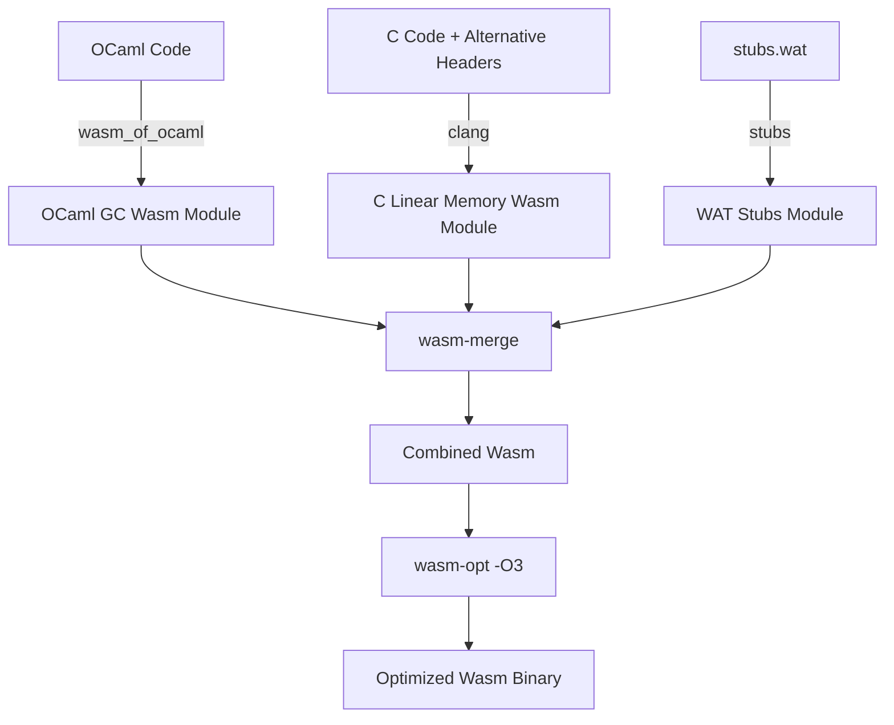

# Compiling and Linking C Code with Wasm_of_ocaml

This document outlines the current manual process for compiling C code and linking it with **wasm_of_ocaml**, and presents a design proposal for streamlining this workflow by modifying the compiler.

---

## Part 1: Current Implementation Strategy

Interfacing OCaml and C in a WebAssembly GC environment is different from a traditional native target due to partitioned memory spaces (the WebAssembly GC heap vs flat linear memory) and different value representation formats.

### 1. Architectural Overview

1. **Memory Spaces**: WebAssembly GC values live on the Wasm engine's garbage-collected heap. Standard C pointer operations can only target WebAssembly **linear memory**.
2. **Type representation**: `wasm_of_ocaml` uses WebAssembly GC reference types (`eqref`, `$block`, `$bytes`) internally. C code compiled with Clang represents opaque host values as `externref` (`__externref_t`).
3. **The Adapter Layer**: We bridge the gap using an alternative `caml/mlvalues.h` header on the C side and hand-written WebAssembly Text (WAT) stubs to convert types and copy buffers.



---

### 2. The Alternative C Headers (`caml/mlvalues.h`)

Since C code cannot read the GC heap directly, we redefine standard OCaml C binding macros to invoke imported helper functions.

```c
#ifndef CAML_MLVALUES_H
#define CAML_MLVALUES_H

#include <stddef.h>

/* OCaml values are represented as opaque WebAssembly external references */
typedef __externref_t value;

/* Primitive conversions */
value caml_val_int(int i);
int caml_int_val(value v);
value caml_val_double(double d);
double caml_double_val(value v);

#define Val_int(x) caml_val_int(x)
#define Int_val(x) caml_int_val(x)
#define Val_double(x) caml_val_double(x)
#define Double_val(x) caml_double_val(x)

#define Val_true caml_val_int(1)
#define Val_false caml_val_int(0)
#define Val_bool(x) caml_val_int((x) ? 1 : 0)
#define Bool_val(x) caml_int_val(x)

/* Block fields and Tags
 * Under wasm_of_ocaml, blocks are Wasm GC arrays where index 0 stores the tag
 * (as an i31ref) and the fields start at index 1.
 */
value caml_field(value v, int i);
void caml_store_field(value v, int i, value w);
int caml_tag_val(value v);

#define Field(v, i) caml_field(v, i)
#define Store_field(v, i, w) caml_store_field(v, i, w)
#define Tag_val(v) caml_tag_val(v)

/* Strings & Bytes
 * GC array characters must be copied to linear memory on demand.
 */
int caml_string_length(value v);
const char* caml_string_val(value v);
char* caml_bytes_val(value v);

#define String_val(v) caml_string_val(v)
#define Bytes_val(v) caml_bytes_val(v)

#endif /* CAML_MLVALUES_H */
```

---

### 3. Wasm GC Stubs (`stubs.wat`)

The WAT stub imports C functions, translates signatures between `(ref eq)` and `externref` types via conversion instructions, and implements GC operations.

```wat
(module
   ;; Import linear memory and allocators exported by the compiled C module
   (import "c_module" "c_memory" (memory 1))
   (import "c_module" "malloc" (func $malloc (param i32) (result i32)))
   
   ;; Import C functions that we want to wrap
   (import "c_module" "my_c_binding" (func $my_c_binding (param externref) (result externref)))

   ;; Wasm GC type definitions matching wasm_of_ocaml
   (type $float (struct (field $f f64)))
   (type $block (array (mut (ref eq))))
   (type $bytes (array (mut i8)))

   ;; Val_int: Int -> externref
   (func (export "caml_val_int") (param $i i32) (result externref)
      (extern.convert_any (ref.i31 (local.get $i))))

   ;; Int_val: externref -> Int
   (func (export "caml_int_val") (param $v externref) (result i32)
      (i31.get_s (ref.cast (ref i31) (any.convert_extern (local.get $v)))))

   ;; Field Access: returns field (i + 1) because index 0 is reserved for the tag
   (func (export "caml_field") (param $v externref) (param $i i32) (result externref)
      (extern.convert_any
         (array.get $block
            (ref.cast (ref $block) (any.convert_extern (local.get $v)))
            (i32.add (local.get $i) (i32.const 1)))))

   ;; Store Field: sets field (i + 1)
   (func (export "caml_store_field") (param $v externref) (param $i i32) (param $w externref)
      (array.set $block
         (ref.cast (ref $block) (any.convert_extern (local.get $v)))
         (i32.add (local.get $i) (i32.const 1))
         (any.convert_extern (local.get $w))))

   ;; String Copying: Copy GC bytes into C linear memory, returns pointer
   (func (export "caml_string_val") (param $v externref) (result i32)
      (local $len i32) (local $addr i32) (local $i i32) (local $bytes_ref (ref $bytes))
      (local.set $bytes_ref (ref.cast (ref $bytes) (any.convert_extern (local.get $v))))
      (local.set $len (array.len (local.get $bytes_ref)))
      (local.set $addr (call $malloc (i32.add (local.get $len) (i32.const 1))))
      (local.set $i (i32.const 0))
      (block $done
         (loop $loop
            (br_if $done (i32.eq (local.get $i) (local.get $len)))
            (i32.store8
               (i32.add (local.get $addr) (local.get $i))
               (array.get_u $bytes (local.get $bytes_ref) (local.get $i)))
            (local.set $i (i32.add (local.get $i) (i32.const 1)))
            (br $loop)))
      (i32.store8 (i32.add (local.get $addr) (local.get $len)) (i32.const 0))
      (local.get $addr))

   ;; OCaml Primitive Bridge wrapper: maps signatures
   (func (export "caml_my_c_binding") (param $v (ref eq)) (result (ref eq))
      (ref.cast (ref eq)
         (any.convert_extern
            (call $my_c_binding
               (extern.convert_any (local.get $v))))))
)
```

---

### 4. Compilation and Linking Commands

1. **Compile C Code**:
   ```bash
   /opt/wasi-sdk/bin/clang -O3 -flto \
     -nodefaultlibs -nostartfiles -ffreestanding \
     -mbulk-memory -mreference-types \
     -Wl,--no-entry \
     -Wl,--export-memory=c_memory \
     my_bindings.c -o c_module.wasm
   ```
2. **Compile OCaml Code**:
   ```bash
   wasm_of_ocaml --target=wasm -o ocaml_module.wasm main.ml
   ```
3. **Merge and Link Wasm Modules**:
   ```bash
   wasmoo_link_wasm.exe \
     -o app.wasm \
     c_module:c_module.wasm \
     stubs:stubs.wat \
     ocaml_module:ocaml_module.wasm
   ```

---

## Part 2: Proposed Compiler Streamlining

Writing manual WAT stubs for every external function is tedious. We propose modifications to `wasm_of_ocaml` to automate this workflow.

### 1. Automatic Wrapper Generation (Auto-Stubs)

Instead of manual stub files, we can modify the compiler to generate marshaling wrappers directly during compiling.
For every OCaml declaration:
```ocaml
external my_c_function : int -> string -> float -> unit = "my_c_function"
```
The compiler can automatically output the correct wrapper function:
- Converts OCaml GC values (e.g. `i31ref` for ints, `$float` struct for floats) to standard C types (`i32`, `f64`).
- Handles strings automatically by calling a memory-copying runtime function.
- Converts OCaml objects to `externref`.
- Restores return types before yielding execution back to OCaml.

### 2. Built-in C-API Bridge Runtime

Instead of requiring developers to include helper implementations (`caml_field`, `caml_alloc`) in their stubs, `wasm_of_ocaml` should integrate them directly into the runtime (`runtime/wasm/obj.wat` and `gc.wat`).
- A single static `caml/mlvalues.h` file can then be shipped with `wasm_of_ocaml` and reused across all projects without modifications.
- Standard C bindings can be compiled directly against these runtime helper exports.

### 3. Integrated Tooling Integration

Extend the `wasm_of_ocaml` CLI to invoke clang and link the compiled linear memory output directly:
```bash
wasm_of_ocaml main.ml --link-c-file=my_bindings.c -o app.wasm
```
Under the hood, the compiler CLI will find `clang` (from the WASI-SDK), run the compilation with the proper flags (LTO, Reference Types), and bundle everything via `wasm-merge` automatically.
