# Performance

We have compared the running time of OCaml programs executed natively, interpreted by the bytecode interpreter, and executed by a JavaScript engine after compilation by Js\_of\_ocaml or Wasm\_of\_ocaml.

With a state-of-the-art JavaScript engine (such as Google's V8), programs usually run faster when compiled to JavaScript than with the OCaml bytecode interpreter, and faster still when compiled to WebAssembly.

Benchmarks were run in October 2026 with OCaml 5\.5 and Node.js 26\.13 (V8 14\.6), on an OVH b3-16 instance (4 vCPUs, AMD EPYC Milan) running Ubuntu 26\.04. Unless stated otherwise, charts show values relative to Js\_of\_ocaml (Js\_of\_ocaml \= 1\). Js\_of\_ocaml and Wasm\_of\_ocaml are run with `--opt=2` (the default is `--opt=1`).

## Execution time

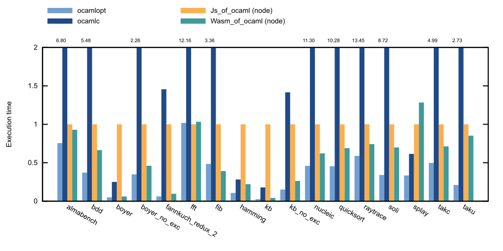
Code compiled by Wasm\_of\_ocaml runs more than twice as fast as code compiled by Js\_of\_ocaml on average, and more than ten times faster on code that uses exceptions heavily. It is slower on splay, which is dominated by string operations.

**Notes on Js\_of\_ocaml**:

- Exceptions are expensive (boyer, kb)
- String operations are slow (splay) because OCaml strings cannot be mapped directly to JavaScript's immutable UTF-16 strings

## Code size

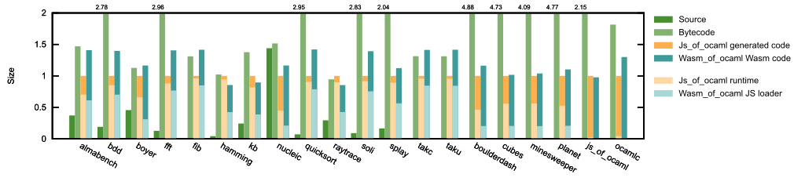
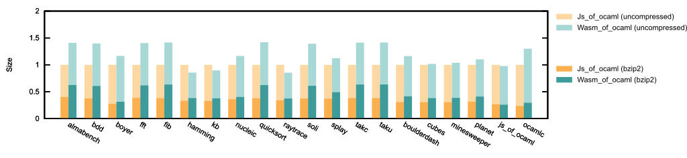
Most of the time, the generated JavaScript code is smaller than the bytecode file. The benchmarks are small programs that do not make much use of any library. The generated code remains smaller than the bytecode file for large programs (ocamlc, js\_of\_ocaml).

The size gain can be much larger for programs that rely on external libraries, thanks to dead code elimination.

The code generated by Wasm\_of\_ocaml, runtime included, is usually somewhat larger than the code generated by Js\_of\_ocaml: about 20% on average. It consists of a JavaScript loader of about 16 to 20 KB, which accounts for half of the output for the smallest programs, and a WebAssembly module.

Once compressed with bzip2, the code generated by Wasm\_of\_ocaml is about 35% larger than the code generated by Js\_of\_ocaml. The second chart shows both sizes: bzip2 reduces the output of Js\_of\_ocaml to about a third of its size, and the output of Wasm\_of\_ocaml to about 40%.

## Compilation time

### Microbenchmarks

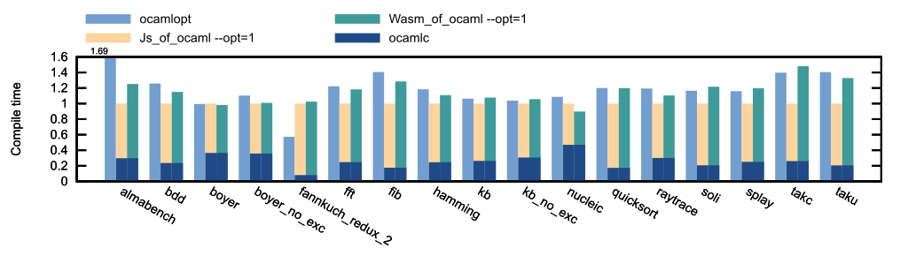
This chart compares the compilers at their default optimization level (`--opt=1`). Js\_of\_ocaml and Wasm\_of\_ocaml compile the bytecode produced by `ocamlc`: their bars include the time taken by `ocamlc` (the darker part), and the chart is relative to `ocamlc` followed by Js\_of\_ocaml. Compiling with `ocamlc` and then Js\_of\_ocaml is about 15% faster than compiling with `ocamlopt` on average.

At this level, Wasm\_of\_ocaml does not run Binaryen. Compiling with `ocamlc` and then Wasm\_of\_ocaml takes about as long as compiling with `ocamlopt`, about 15% longer than with Js\_of\_ocaml.

### Example programs

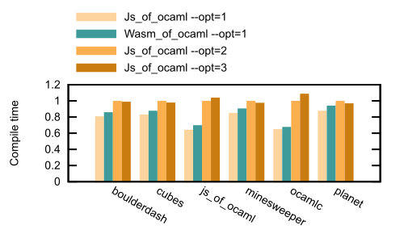
These programs are compiled from existing bytecode files, so this chart only compares Js\_of\_ocaml and Wasm\_of\_ocaml, relative to Js\_of\_ocaml with `--opt=2`.

At `--opt=1`, Wasm\_of\_ocaml is about 5% to 10% slower than Js\_of\_ocaml at the same level. At `--opt=2` and `--opt=3`, it optimizes the generated code with Binaryen's `wasm-opt`, which makes compilation much longer: two to three times longer than with Js\_of\_ocaml. Js\_of\_ocaml itself compiles the largest programs (js\_of\_ocaml and ocamlc) about 35% faster at `--opt=1` than at `--opt=2`.

## Comparison with handwritten JavaScript

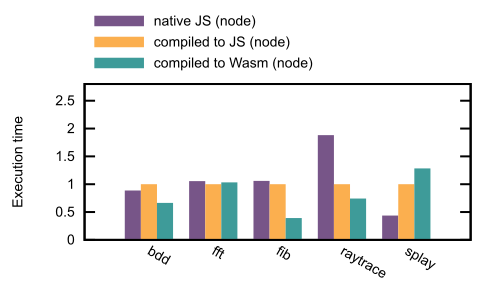
Comparing execution times between handwritten JavaScript and generated code shows that results are implementation-dependent. Code compiled by Js\_of\_ocaml runs about as fast as the handwritten JavaScript on bdd, fft and fib. It is faster on raytrace and slower on splay, which is dominated by string operations. Code compiled by Wasm\_of\_ocaml is faster than the handwritten JavaScript on bdd, fib and raytrace, as fast on fft, and slower on splay.

## Compiler optimization levels

### Js\_of\_ocaml

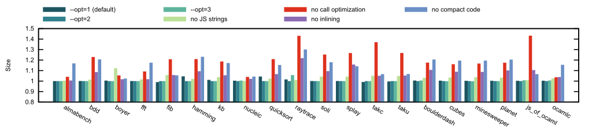
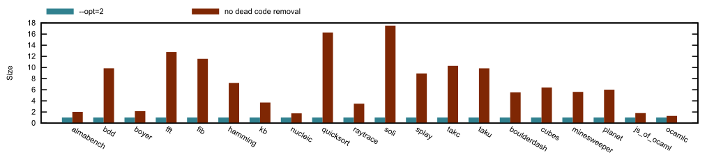
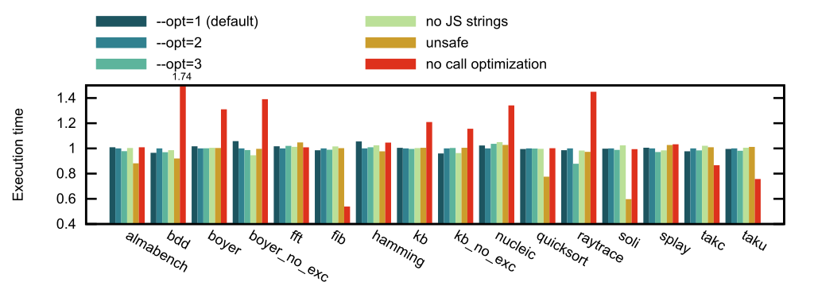
These charts are relative to Js\_of\_ocaml with `--opt=2`, the level used in the other charts. They show the other optimization levels and the effect of disabling some optimizations. The `-unsafe` variant is compiled from bytecode built with `ocamlc -unsafe`.

- `--opt=1`, `--opt=2` and `--opt=3` perform the same on these benchmarks.
- Dead code elimination matters most for size (second chart): without it, the generated code is up to 17 times larger.
- Without the optimization of calls, the code is about 20% larger and often slower (up to 1\.7 times slower on bdd), but faster on fib, takc and taku.
- Disabling inlining or compact output makes the code about 5% to 15% larger.
- Representing OCaml strings as JavaScript strings (`--disable=use-js-string` turns this off) has no measurable impact on speed on these benchmarks, and makes the code slightly smaller.
- Removing bounds checking (`-unsafe`) mostly helps array-intensive code (quicksort, soli).

### Wasm\_of\_ocaml

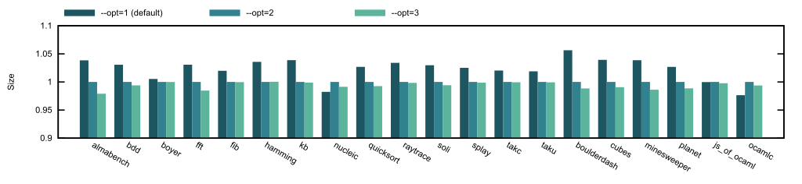
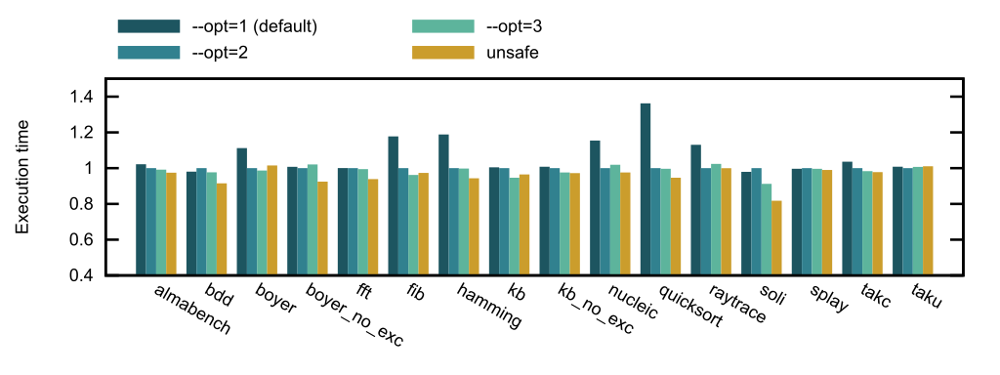
These charts are relative to Wasm\_of\_ocaml with `--opt=2`, which uses Binaryen's `wasm-opt` to optimize the generated code.

- At the default level (`--opt=1`), Binaryen is not run: the code is up to 6% larger and slightly slower (7% on average, up to 38% on quicksort).
- `--opt=3` brings little over `--opt=2` on these benchmarks.
- Removing bounds checking (`-unsafe`) makes the code about 4% faster on average (up to 15% on soli).

## Effect handlers impact

### Js\_of\_ocaml

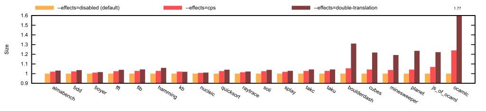
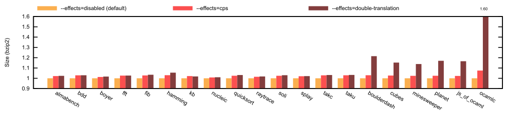
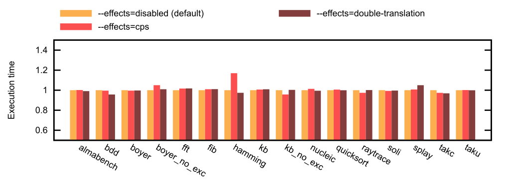
The performance impact of supporting effect handlers:

**Size**:

- With `--effects=cps`, code is about 2% larger for small programs, 4% to 7% larger for the examples, and 24% larger for ocamlc
- With `--effects=double-translation`, which duplicates the functions that may perform effects, code is about 3% larger for small programs, 20% to 30% larger for the examples, and 77% larger for ocamlc
- For small programs, most of the increase comes from the runtime, which is larger when effects are enabled
- The impact on compressed code is lower for larger programs since we add many function definitions, which are verbose in JavaScript but compress well (60% instead of 77% for ocamlc with `--effects=double-translation`)
- Code using `Lwt`, `Async`, or `Incremental` can see a larger increase
**Speed**:

- Almost no impact for small monomorphic programs
- Can be larger for code that heavily uses higher-order functions and polymorphism (`Lwt` code, for instance)

### Wasm\_of\_ocaml

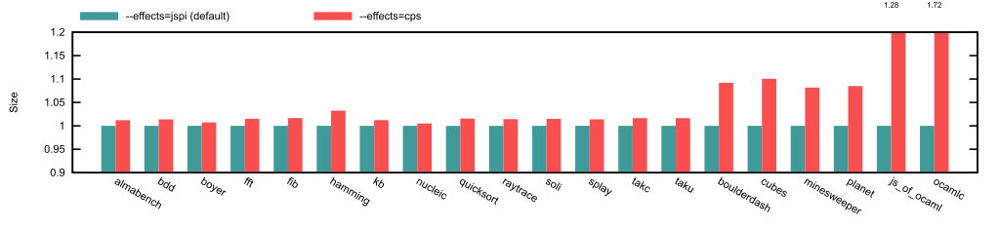

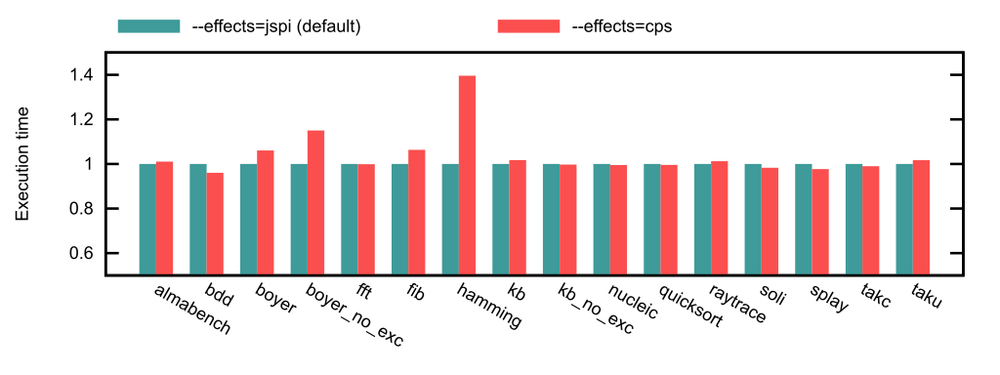
These charts are relative to the default Wasm\_of\_ocaml configuration. By default, Wasm\_of\_ocaml implements effect handlers with JavaScript Promise Integration (`--effects=jspi`), which does not require transforming the code. With `--effects=cps`, the code is slightly larger for small programs, about 10% larger for the examples, and up to 70% larger for ocamlc. Unlike with Js\_of\_ocaml, compression does not reduce this increase: compressed with bzip2, ocamlc is twice as large with `--effects=cps`. Execution time is mostly unchanged, except on hamming (40% slower).
